# Benchmark report

Generated by `scripts/bench_report.py` on 2026-11-12 from the benchmark run described in [journal 0016](../../journal/0016_benchmark-v1-six-objects.md) (plan: [05_benchmark_plan.md](../../05_benchmark_plan.md)). For every example: the input photos, each held-out photo next to every method's render of the same view, and four views of every method's model.

**Methods:**
- `v0`: DA3 cameras, carving;
- `v1.2 recon`: reconstruction only;
- `gen only`: UniForge3D's own colours;
- `gen + colour map`: the same, after one global colour correction;
- `v2.3`: raw UniForge3D mesh with photo colours;
- `v2.3.1 (current)`: repaired mesh with photo colours;
- `oracle`: the true mesh with photo colours (synthetic examples only).

**Metrics** are on held-out views, from exact renders:
- silhouette IoU;
- coverage (share of object pixels the model covers);
- PSNR over the whole object mask (`psnr_full`) and over the covered part (`psnr_cov`);
- synthetic examples add the low held-out views (`*_low`) and geometry against the true mesh (Chamfer as % of the bounding-box diagonal, F-score at 2 %).

**3D models are not in the repo** (GLB, ~1 GB). `scripts/bench_report.py` writes them locally to `~/ComfyUI-Shared/input/3d/ysda_bench/<example>/<method>.glb`, for ComfyUI's Load 3D node.

**Data and licences:**
- `co3d_*`: frames of [CO3D-small](https://huggingface.co/datasets/XeemPad/CO3D-small) sequences (CO3D, Meta AI, CC BY-NC 4.0);
- `gso_*`: renders of [Google Scanned Objects](https://huggingface.co/datasets/hugging-3d/google-scanned-objects) (Google LLC, CC BY 4.0), made by `ysda3d/synth.py`;
- `toy`: our own photos (`data/toy/images`).

## Summary

### all examples: 6 examples (toy, co3d_cup, co3d_plant, gso_sofa, gso_mug, gso_shoe)

| method | IoU | PSNR full | PSNR cov |
|---|---|---|---|
| recon_v0 | 0.657 ± 0.192 | 9.17 ± 2.38 | 15.08 ± 2.73 |
| recon_v1_2 | 0.939 ± 0.045 | 17.12 ± 3.41 | 21.82 ± 3.34 |
| gen_only | **0.961 ± 0.007** | 11.30 ± 2.16 | 11.89 ± 2.42 |
| gen_harmonised | 0.961 ± 0.007 | 15.14 ± 1.58 | 16.91 ± 1.79 |
| fused_v2_3 | 0.959 ± 0.017 | 17.79 ± 2.76 | 22.46 ± 3.88 |
| fused_v2_3_1 | 0.961 ± 0.007 | **18.04 ± 2.08** | **22.81 ± 3.24** |

### real photos: 3 examples (toy, co3d_cup, co3d_plant)

| method | IoU | PSNR full | PSNR cov |
|---|---|---|---|
| recon_v0 | 0.547 ± 0.185 | 7.34 ± 1.08 | 13.91 ± 1.90 |
| recon_v1_2 | 0.910 ± 0.047 | 14.45 ± 2.53 | 19.32 ± 0.96 |
| gen_only | **0.957 ± 0.005** | 11.29 ± 2.68 | 12.07 ± 3.07 |
| gen_harmonised | 0.957 ± 0.005 | 14.89 ± 1.05 | 17.01 ± 1.32 |
| fused_v2_3 | 0.948 ± 0.016 | 16.05 ± 2.07 | 20.10 ± 2.21 |
| fused_v2_3_1 | 0.957 ± 0.005 | **16.88 ± 1.42** | **20.98 ± 1.79** |

### synthetic (with ground truth): 3 examples (gso_sofa, gso_mug, gso_shoe)

| method | IoU | PSNR full | PSNR cov | IoU low | PSNR low | Chamfer % | F@1% | F@2% | Prec@2% | Rec@2% |
|---|---|---|---|---|---|---|---|---|---|---|
| recon_v0 | 0.766 ± 0.125 | 11.00 ± 1.85 | 16.25 ± 2.93 | 0.756 ± 0.073 | 10.60 ± 2.30 | 2.46 ± 0.60 | 0.376 ± 0.099 | 0.634 ± 0.057 | 0.727 ± 0.077 | 0.564 ± 0.054 |
| recon_v1_2 | 0.969 ± 0.003 | 19.79 ± 1.58 | 24.31 ± 2.98 | 0.922 ± 0.018 | 18.80 ± 1.93 | 1.57 ± 0.31 | 0.624 ± 0.059 | 0.755 ± 0.030 | 0.822 ± 0.059 | 0.699 ± 0.014 |
| gen_only | 0.966 ± 0.007 | 11.31 ± 1.47 | 11.72 ± 1.50 | 0.960 ± 0.006 | 10.85 ± 0.98 | 0.61 ± 0.12 | 0.867 ± 0.052 | 0.950 ± 0.040 | 0.951 ± 0.031 | 0.949 ± 0.051 |
| gen_harmonised | 0.966 ± 0.007 | 15.39 ± 1.94 | 16.82 ± 2.15 | 0.960 ± 0.006 | 15.81 ± 1.94 | 0.61 ± 0.12 | 0.867 ± 0.052 | 0.950 ± 0.040 | 0.951 ± 0.031 | 0.949 ± 0.051 |
| fused_v2_3 | 0.971 ± 0.007 | 19.52 ± 2.22 | 24.82 ± 3.74 | 0.965 ± 0.009 | 18.39 ± 2.21 | 0.56 ± 0.12 | 0.885 ± 0.062 | 0.954 ± 0.037 | 0.961 ± 0.031 | 0.947 ± 0.043 |
| fused_v2_3_1 | 0.966 ± 0.007 | 19.20 ± 1.98 | 24.65 ± 3.33 | 0.960 ± 0.006 | 18.18 ± 2.21 | 0.61 ± 0.12 | 0.867 ± 0.052 | 0.950 ± 0.040 | 0.951 ± 0.031 | 0.949 ± 0.051 |
| oracle_gt_mesh | 0.994 ± 0.003 | 26.97 ± 2.24 | 30.24 ± 3.44 | 0.995 ± 0.002 | 25.93 ± 1.70 | 0.15 ± 0.02 | 1.000 ± 0.000 | 1.000 ± 0.000 | 1.000 ± 0.000 | 1.000 ± 0.000 |

### paired: `fused_v2_3_1` minus each method, per example (median Δ, wins–losses of `fused_v2_3_1`)

Averages can hide one example carrying a method; the median and the win count do not.

| vs method | IoU | PSNR full | PSNR cov | coverage | Chamfer % (synth.) | F@2% (synth.) |
|---|---|---|---|---|---|---|
| recon_v0 | +0.281 (6–0) | +9.266 (6–0) | +7.302 (6–0) | +0.281 (6–0) | -1.652 (3–0) | +0.329 (3–0) |
| recon_v1_2 | +0.007 (5–1) | -0.215 (3–3) | +0.513 (5–1) | +0.004 (4–2) | -0.906 (3–0) | +0.186 (3–0) |
| gen_only | +0.000 (0–0) | +7.033 (6–0) | +9.927 (6–0) | +0.000 (0–0) | +0.000 (0–0) | +0.000 (0–0) |
| gen_harmonised | +0.000 (0–0) | +3.094 (6–0) | +5.553 (6–0) | +0.000 (0–0) | +0.000 (0–0) | +0.000 (0–0) |
| fused_v2_3 | -0.003 (2–4) | +0.015 (3–3) | +0.022 (3–3) | +0.001 (3–3) | +0.051 (0–3) | -0.006 (1–2) |

### per example: PSNR full / IoU (held-out views)

| method | toy | co3d_cup | co3d_plant | gso_sofa | gso_mug | gso_shoe |
|---|---|---|---|---|---|---|
| recon_v0 | 8.44 / 0.710 | 5.88 / 0.288 | 7.69 / 0.644 | 13.15 / 0.809 | 8.63 / 0.597 | 11.21 / 0.894 |
| recon_v1_2 | 16.84 / 0.939 | 15.57 / 0.947 | 10.94 / 0.843 | 20.94 / 0.966 | 20.89 / 0.967 | 17.56 / 0.974 |
| gen_only | 10.69 / 0.951 | 8.34 / 0.956 | 14.83 / 0.964 | 13.39 / 0.969 | 10.23 / 0.971 | 10.30 / 0.956 |
| gen_harmonised | 14.58 / 0.951 | 13.78 / 0.956 | 16.29 / 0.964 | 17.88 / 0.969 | 15.13 / 0.971 | 13.15 / 0.956 |
| fused_v2_3 | 13.61 / 0.926 | 15.87 / 0.952 | 18.66 / 0.965 | 22.25 / 0.974 | 19.52 / 0.977 | 16.81 / 0.960 |
| fused_v2_3_1 | 15.80 / 0.951 | 15.95 / 0.956 | 18.88 / 0.964 | 21.61 / 0.969 | 19.25 / 0.971 | 16.75 / 0.956 |
| oracle_gt_mesh | needs ground truth | needs ground truth | needs ground truth | 29.00 / 0.996 | 28.06 / 0.997 | 23.84 / 0.990 |

## Examples

[toy](#toy) · [co3d_cup](#co3d_cup) · [co3d_plant](#co3d_plant) · [gso_sofa](#gso_sofa) · [gso_mug](#gso_mug) · [gso_shoe](#gso_shoe)

## toy

real; source: data/toy/images (our photos, in this repo); licence: ours; 17 registered photos, of which 3 held out.

| method | iou | coverage | psnr_full | psnr_cov |
|---|---|---|---|---|
| v0 | 0.710 | 0.729 | 8.443 | 13.234 |
| v1.2 recon | 0.939 | 0.970 | 16.836 | 20.567 |
| gen only | 0.951 | 0.956 | 10.688 | 11.598 |
| gen + colour map | 0.951 | 0.956 | 14.584 | 17.751 |
| v2.3 | 0.926 | 0.932 | 13.611 | 18.325 |
| v2.3.1 (current) | 0.951 | 0.956 | 15.805 | 21.099 |

**Input photos (red = held out, blue = given to the generator)**

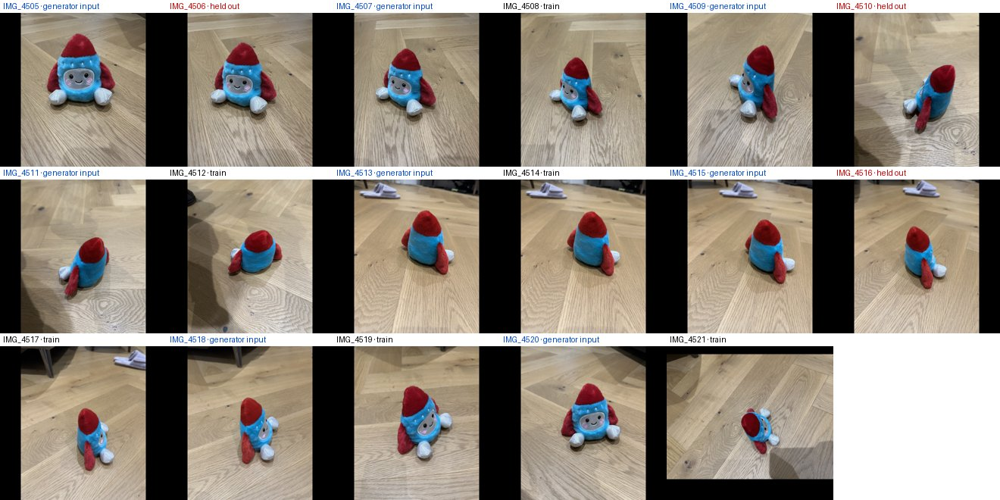

**Held-out photos vs each method (PSNR inside the mask)**

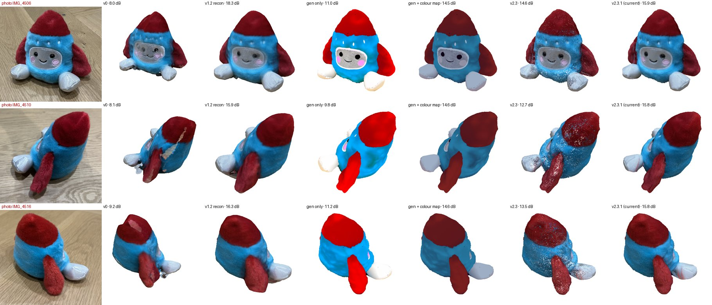

**Models: front, right, back, top**

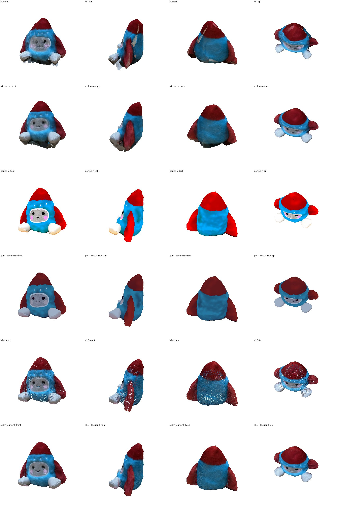

## co3d_cup

real; source: XeemPad/CO3D-small/co3d_subset20k/cup/620_101304_203141; licence: CC BY-NC 4.0 (CO3D); 36 registered photos, of which 3 held out.

| method | iou | coverage | psnr_full | psnr_cov |
|---|---|---|---|---|
| v0 | 0.288 | 0.288 | 5.877 | 11.999 |
| v1.2 recon | 0.947 | 0.960 | 15.570 | 18.244 |
| gen only | 0.956 | 0.961 | 8.340 | 8.562 |
| gen + colour map | 0.956 | 0.961 | 13.781 | 15.164 |
| v2.3 | 0.952 | 0.959 | 15.866 | 18.753 |
| v2.3.1 (current) | 0.956 | 0.961 | 15.953 | 18.738 |

**Input photos (red = held out, blue = given to the generator)**

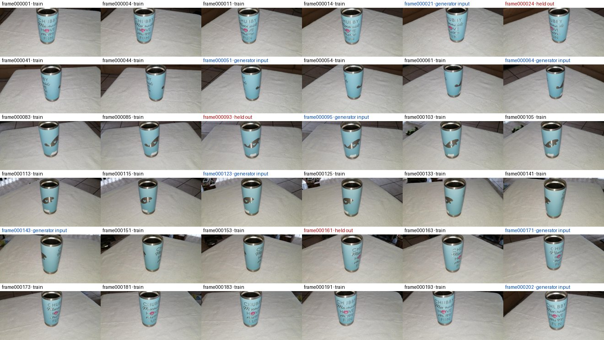

**Held-out photos vs each method (PSNR inside the mask)**

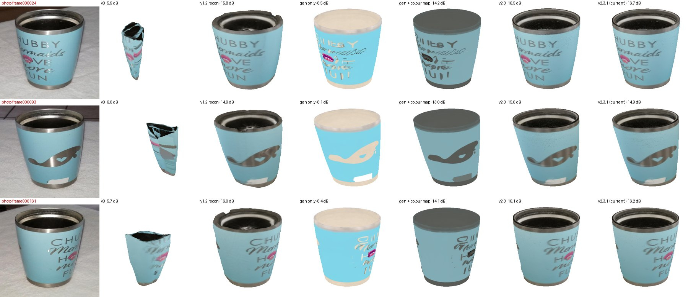

**Models: front, right, back, top**

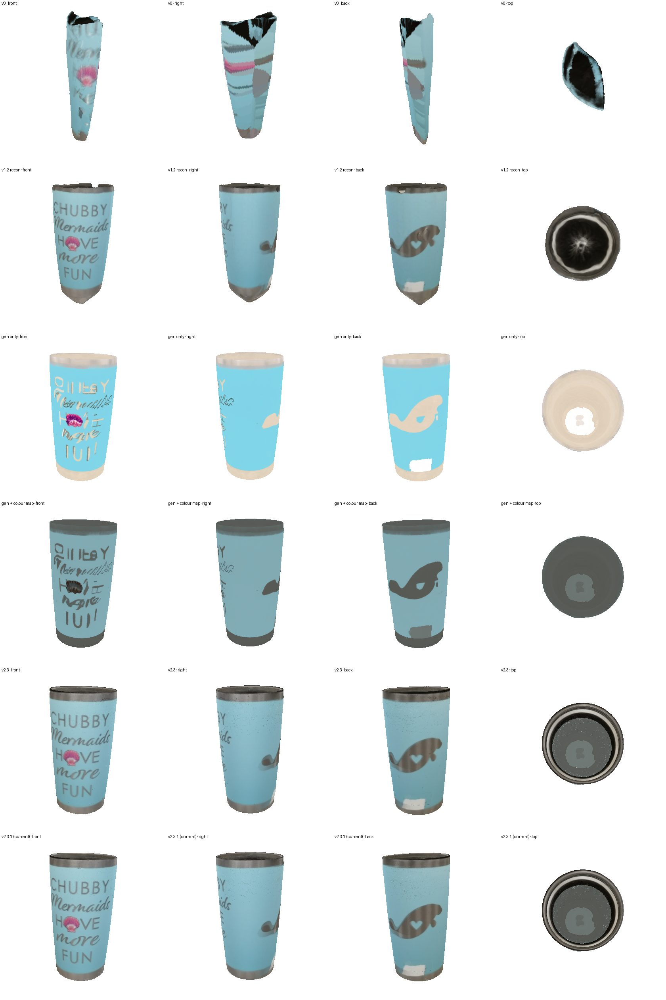

## co3d_plant

real; source: XeemPad/CO3D-small/co3d_subset20k/plant/377_43429_86420; licence: CC BY-NC 4.0 (CO3D); 40 registered photos, of which 3 held out.

| method | iou | coverage | psnr_full | psnr_cov |
|---|---|---|---|---|
| v0 | 0.644 | 0.645 | 7.690 | 16.500 |
| v1.2 recon | 0.843 | 0.845 | 10.944 | 19.150 |
| gen only | 0.964 | 0.980 | 14.833 | 16.040 |
| gen + colour map | 0.964 | 0.980 | 16.292 | 18.123 |
| v2.3 | 0.965 | 0.978 | 18.663 | 23.215 |
| v2.3.1 (current) | 0.964 | 0.980 | 18.878 | 23.111 |

**Input photos (red = held out, blue = given to the generator)**

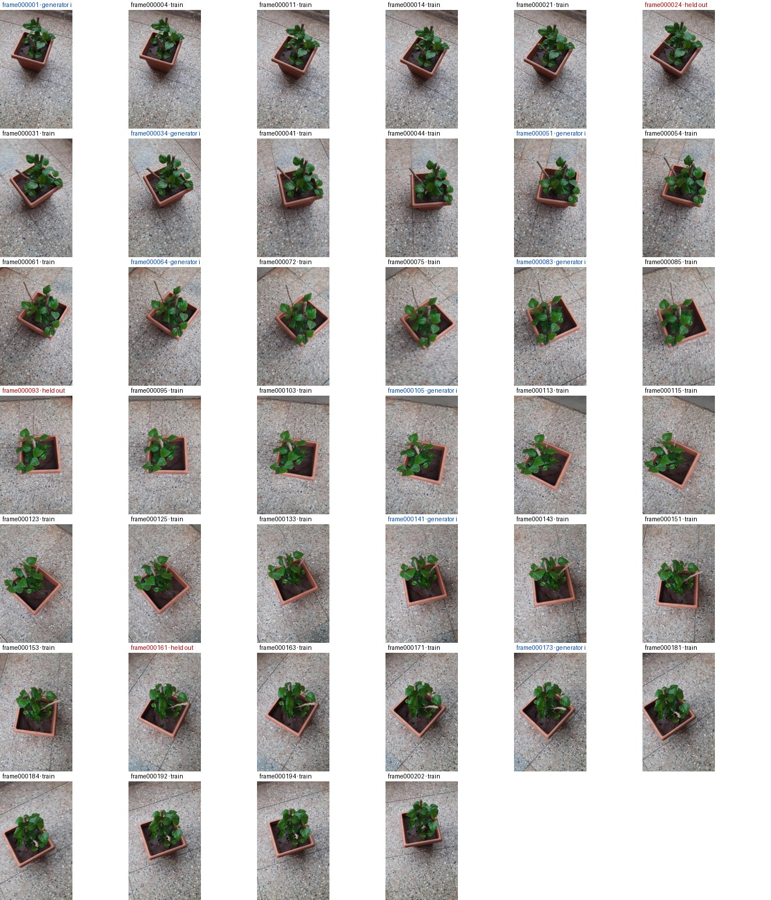

**Held-out photos vs each method (PSNR inside the mask)**

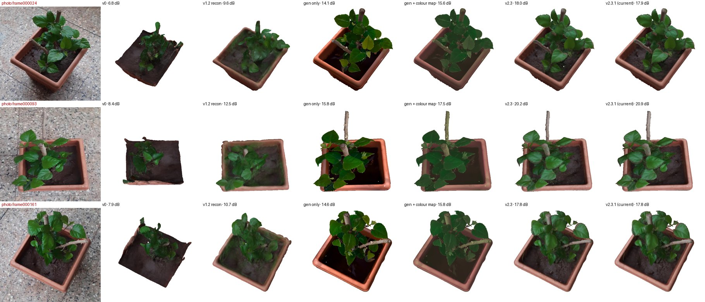

**Models: front, right, back, top**

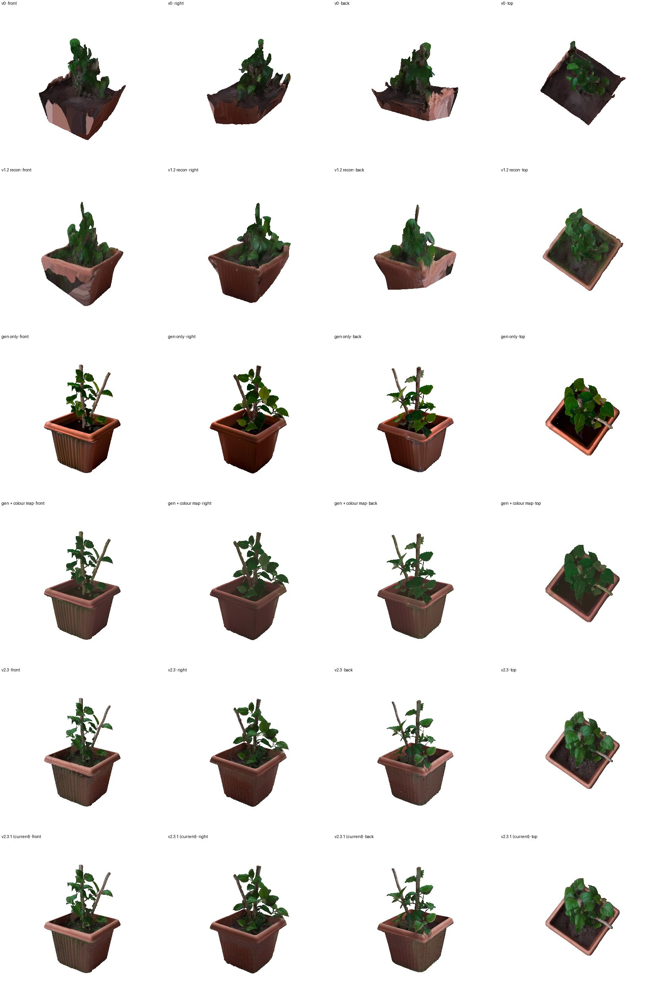

## gso_sofa

synthetic; source: hugging-3d/google-scanned-objects: 3D_Dollhouse_Sofa; licence: CC BY 4.0 (Google Scanned Objects); 25 registered photos, of which 5 held out.

| method | iou | coverage | psnr_full | psnr_cov | iou_low | psnr_full_low | chamfer_pct | fscore_2pct |
|---|---|---|---|---|---|---|---|---|
| v0 | 0.809 | 0.817 | 13.153 | 20.381 | 0.741 | 12.681 | 2.393 | 0.569 |
| v1.2 recon | 0.966 | 0.967 | 20.937 | 27.576 | 0.900 | 21.262 | 2.008 | 0.712 |
| gen only | 0.969 | 0.975 | 13.387 | 13.840 | 0.966 | 12.215 | 0.741 | 0.898 |
| gen + colour map | 0.969 | 0.975 | 17.882 | 19.569 | 0.966 | 18.458 | 0.741 | 0.898 |
| v2.3 | 0.974 | 0.979 | 22.245 | 29.367 | 0.969 | 20.915 | 0.660 | 0.906 |
| v2.3.1 (current) | 0.969 | 0.975 | 21.608 | 28.568 | 0.966 | 20.893 | 0.741 | 0.898 |
| oracle (true mesh) | 0.996 | 0.997 | 28.998 | 34.246 | 0.996 | 27.866 | 0.144 | 1.000 |

**Input photos (red = held out, blue = given to the generator)**

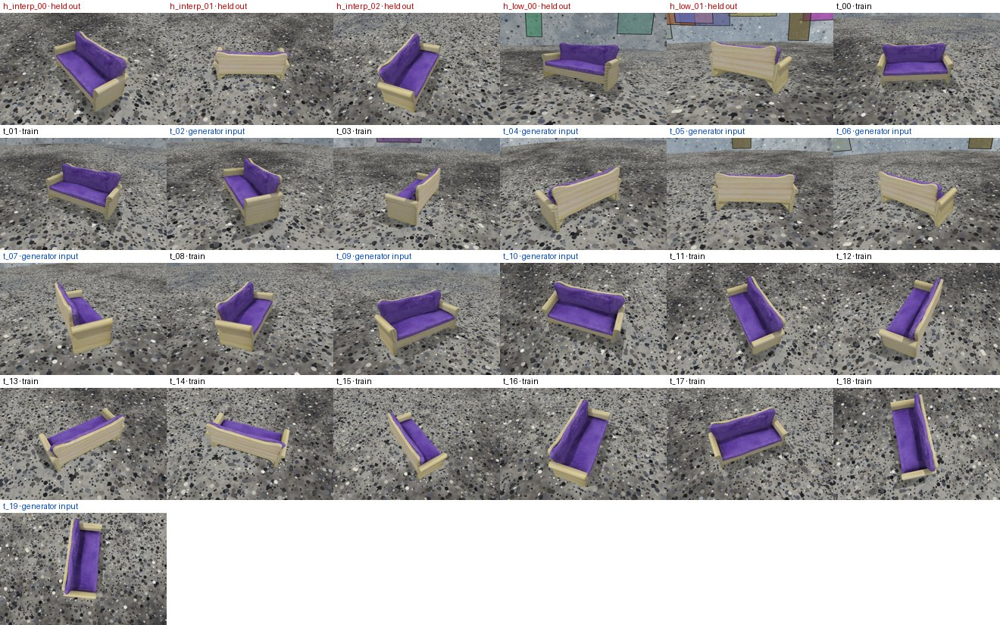

**Held-out photos vs each method (PSNR inside the mask)**

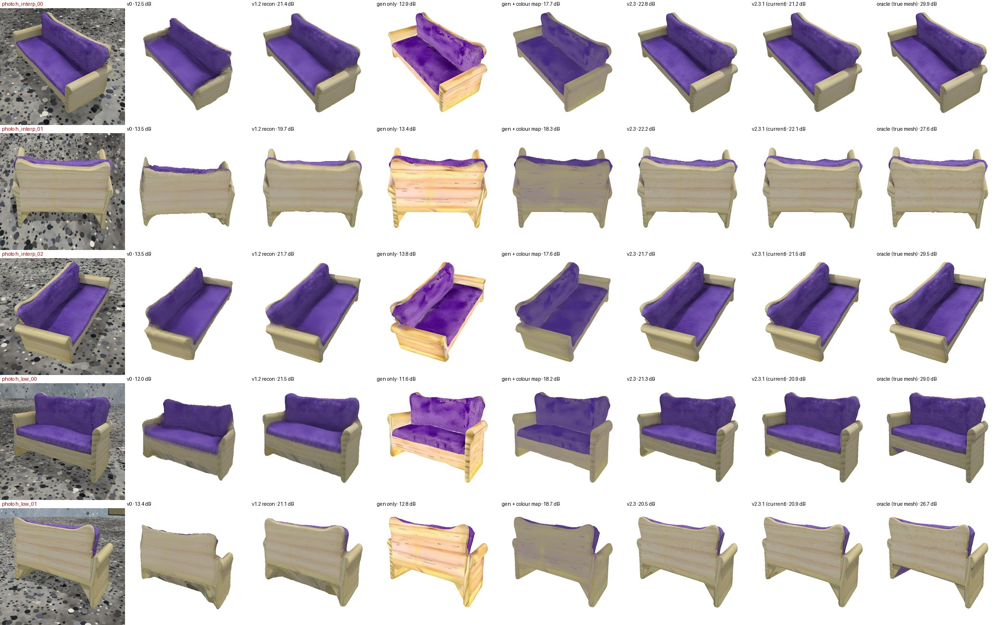

**Models: front, right, back, top (last row: the true mesh)**

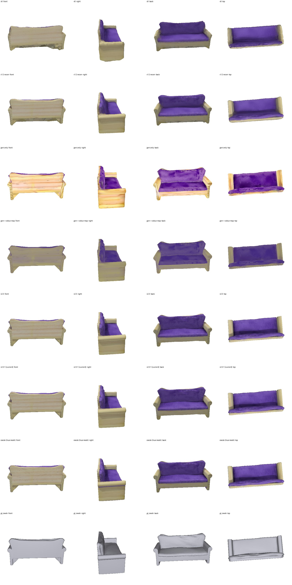

## gso_mug

synthetic; source: hugging-3d/google-scanned-objects: ACE_Coffee_Mug_Kristen_16_oz_cup; licence: CC BY 4.0 (Google Scanned Objects); 25 registered photos, of which 5 held out.

| method | iou | coverage | psnr_full | psnr_cov | iou_low | psnr_full_low | chamfer_pct | fscore_2pct |
|---|---|---|---|---|---|---|---|---|
| v0 | 0.597 | 0.598 | 8.628 | 14.503 | 0.674 | 7.403 | 3.223 | 0.625 |
| v1.2 recon | 0.967 | 0.975 | 20.885 | 24.992 | 0.944 | 18.594 | 1.348 | 0.775 |
| gen only | 0.971 | 0.981 | 10.234 | 10.572 | 0.962 | 9.943 | 0.442 | 0.996 |
| gen + colour map | 0.971 | 0.981 | 15.126 | 16.575 | 0.962 | 15.116 | 0.442 | 0.996 |
| v2.3 | 0.977 | 0.982 | 19.522 | 24.885 | 0.974 | 18.743 | 0.391 | 0.996 |
| v2.3.1 (current) | 0.971 | 0.981 | 19.254 | 24.943 | 0.962 | 18.157 | 0.442 | 0.996 |
| oracle (true mesh) | 0.997 | 0.997 | 28.059 | 30.609 | 0.996 | 26.206 | 0.170 | 1.000 |

**Input photos (red = held out, blue = given to the generator)**

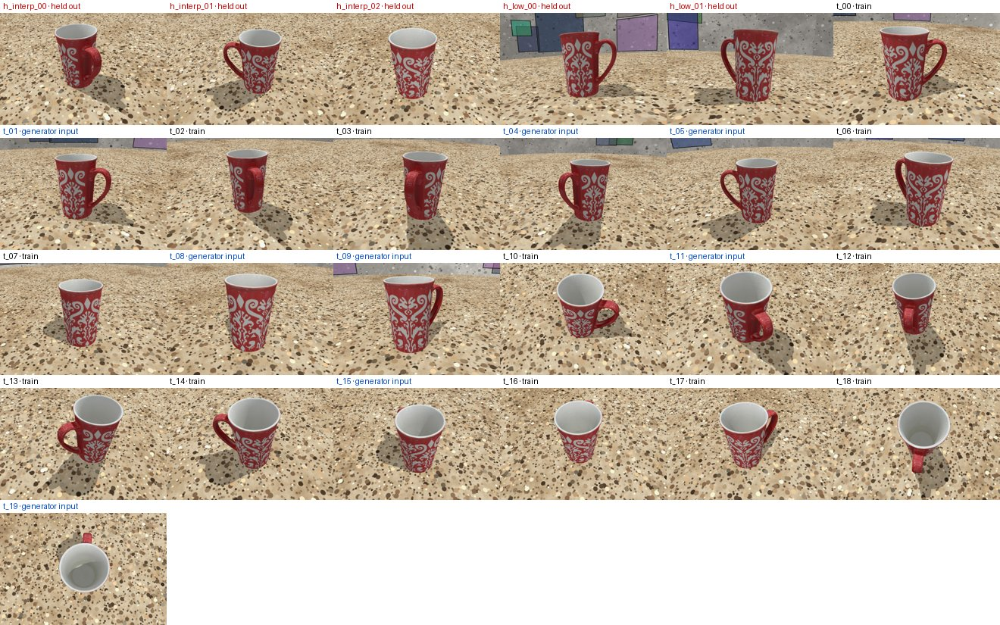

**Held-out photos vs each method (PSNR inside the mask)**

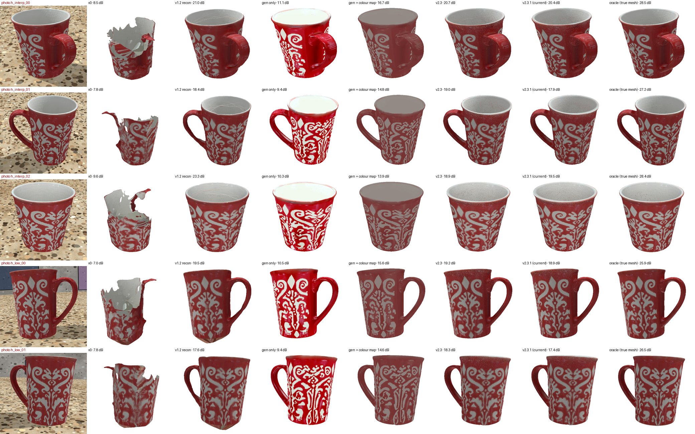

**Models: front, right, back, top (last row: the true mesh)**

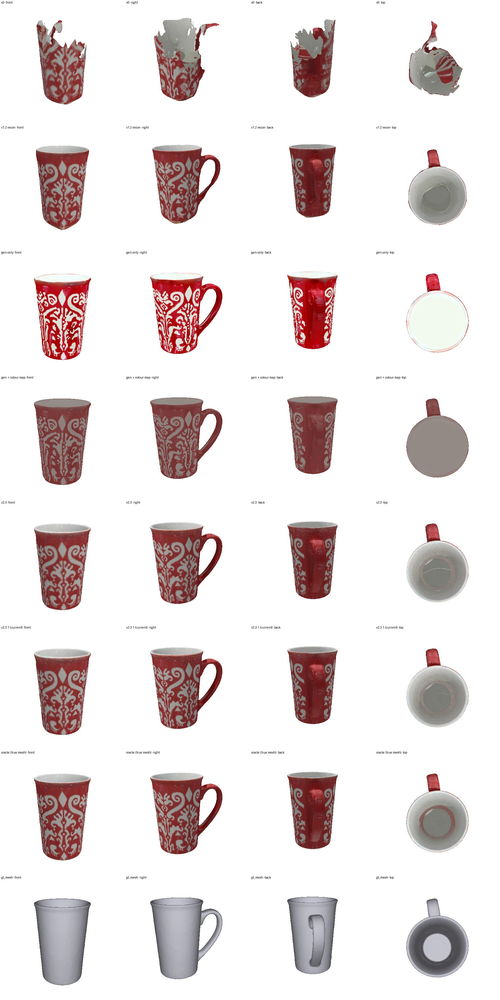

## gso_shoe

synthetic; source: hugging-3d/google-scanned-objects: ASICS_GEL1140V_WhiteBlackSilver; licence: CC BY 4.0 (Google Scanned Objects); 25 registered photos, of which 5 held out.

| method | iou | coverage | psnr_full | psnr_cov | iou_low | psnr_full_low | chamfer_pct | fscore_2pct |
|---|---|---|---|---|---|---|---|---|
| v0 | 0.894 | 0.899 | 11.208 | 13.871 | 0.852 | 11.727 | 1.757 | 0.709 |
| v1.2 recon | 0.974 | 0.978 | 17.562 | 20.374 | 0.922 | 16.557 | 1.353 | 0.778 |
| gen only | 0.956 | 0.961 | 10.296 | 10.748 | 0.952 | 10.391 | 0.644 | 0.955 |
| gen + colour map | 0.956 | 0.961 | 13.148 | 14.307 | 0.952 | 13.865 | 0.644 | 0.955 |
| v2.3 | 0.960 | 0.964 | 16.807 | 20.196 | 0.954 | 15.526 | 0.631 | 0.961 |
| v2.3.1 (current) | 0.956 | 0.961 | 16.750 | 20.425 | 0.952 | 15.491 | 0.644 | 0.955 |
| oracle (true mesh) | 0.990 | 0.994 | 23.843 | 25.855 | 0.992 | 23.722 | 0.133 | 1.000 |

**Input photos (red = held out, blue = given to the generator)**

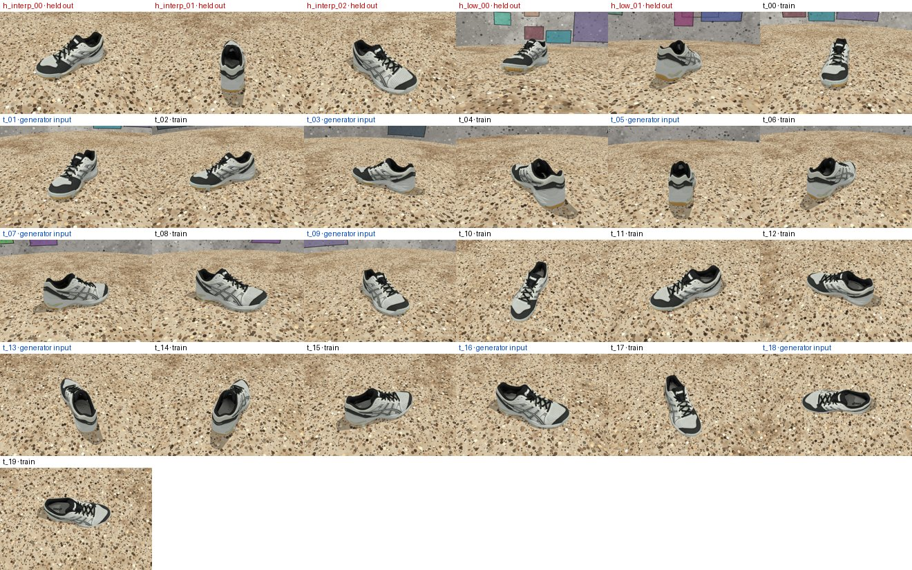

**Held-out photos vs each method (PSNR inside the mask)**

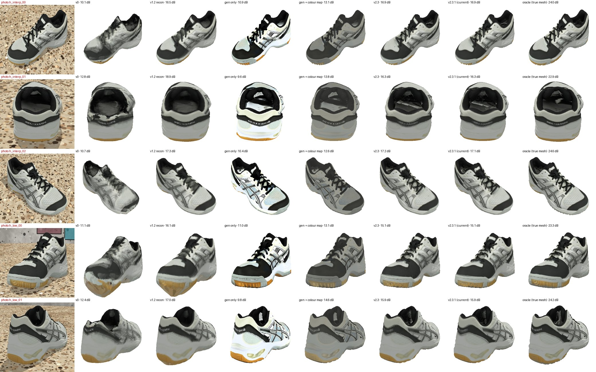

**Models: front, right, back, top (last row: the true mesh)**

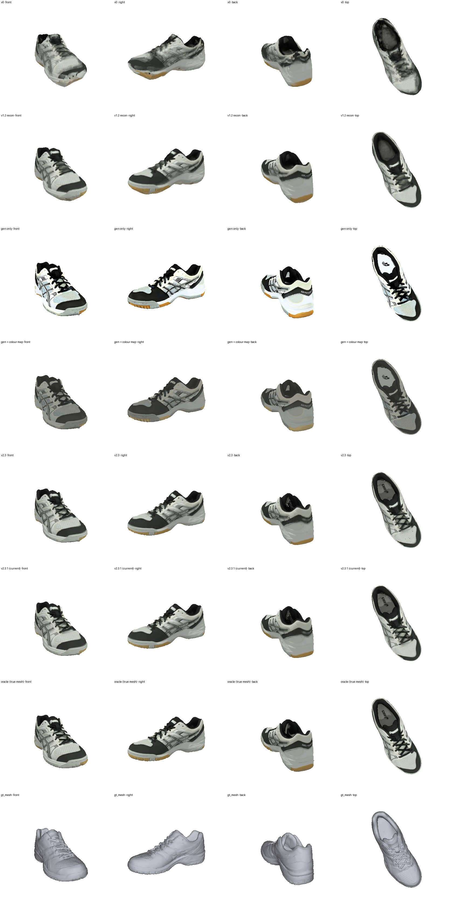

