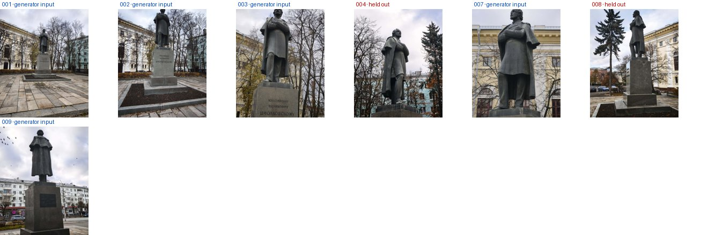
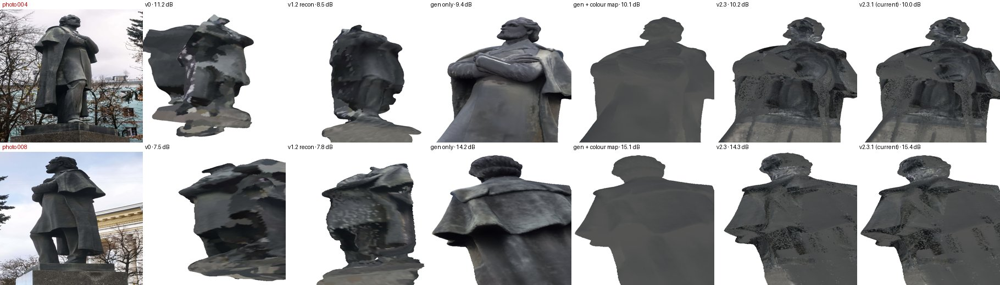
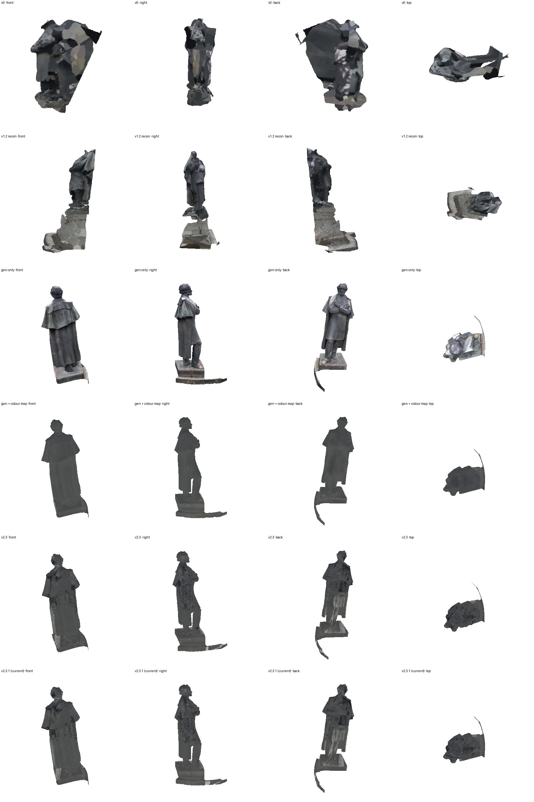
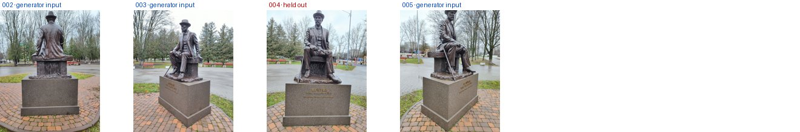
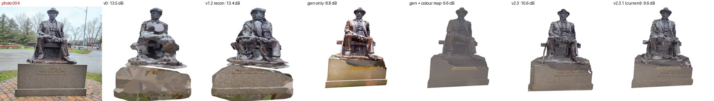
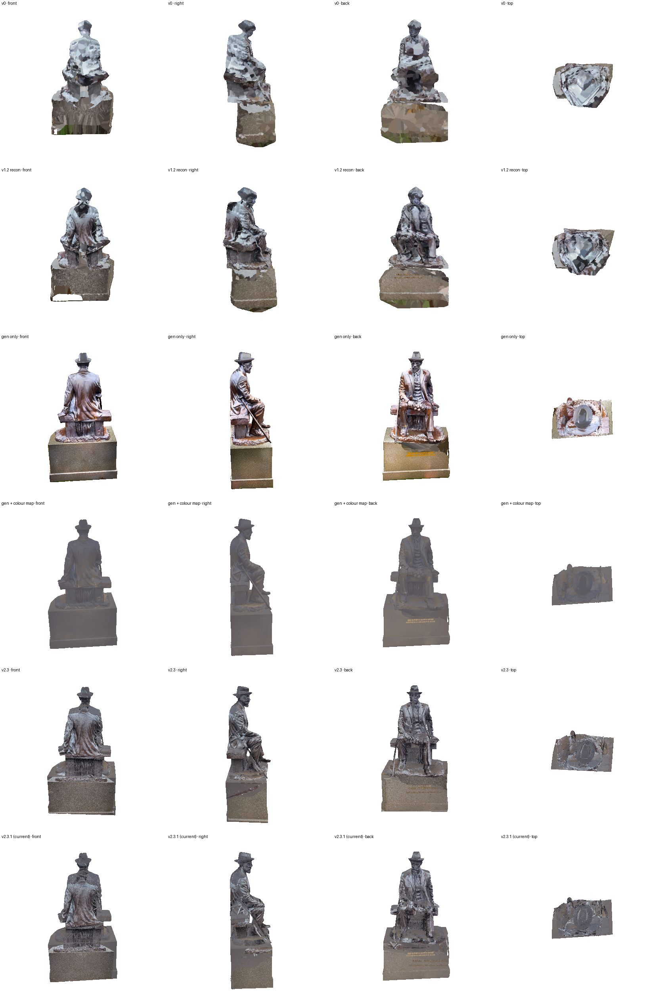
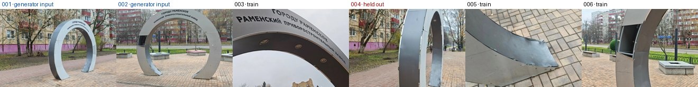
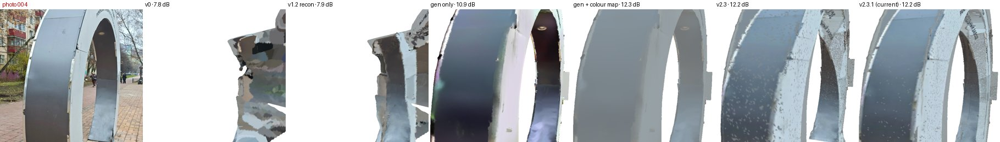
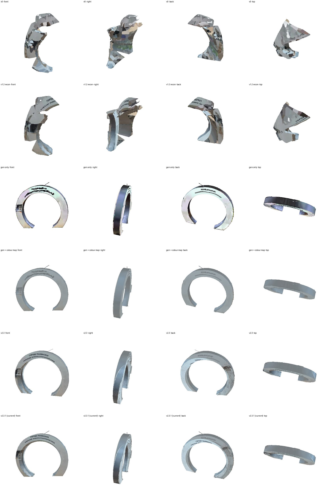

# Benchmark report: own sparse captures (three monuments)

Generated by `scripts/bench_report.py` on 2026-11-25 from the benchmark run described in [journal 0017](../../journal/0017_monuments-sparse-own-captures.md) (plan: [05_benchmark_plan.md](../../05_benchmark_plan.md)). For every example: the input photos, each held-out photo next to every method's render of the same view, and four views of every method's model.

**Methods:**
- `v0`: DA3 cameras, carving;
- `v1.2 recon`: reconstruction only;
- `gen only`: UniForge3D's own colours;
- `gen + colour map`: the same, after one global colour correction;
- `v2.3`: raw UniForge3D mesh with photo colours;
- `v2.3.1 (current)`: repaired mesh with photo colours;
- `oracle`: the true mesh with photo colours (synthetic examples only).

**Metrics** are on held-out views, from exact renders:
- silhouette IoU;
- coverage (share of object pixels the model covers);
- PSNR over the whole object mask (`psnr_full`) and over the covered part (`psnr_cov`);
- synthetic examples add the low held-out views (`*_low`) and geometry against the true mesh (Chamfer as % of the bounding-box diagonal, F-score at 2 %).

**3D models are not in the repo** (GLB, ~1 GB). `scripts/bench_report.py` writes them locally to `~/ComfyUI-Shared/input/3d/ysda_bench/<example>/<method>.glb`, for ComfyUI's Load 3D node.

**Data and licences:**
- `monument_*`: our own photos of public monuments (no location data; not stored in the repo apart from these thumbnails).

> **Note:** These captures are too sparse for COLMAP (3 of 9, 0 of 4 and 0 of 6 photos registered), so every method uses DA3's camera estimates, which disagree with each other (camera check 0.51–0.69; consistent cameras give about 0.9). Held-out scores therefore partly measure camera error, and they favour blurry models over sharp ones that are slightly misaligned. The model images are the more reliable comparison. Details in journal 0017.

## Summary

### all examples: 3 examples (monument_589, monument_616, monument_625)

| method | IoU | PSNR full | PSNR cov |
|---|---|---|---|
| recon_v0 | 0.451 ± 0.266 | 10.19 ± 2.41 | 14.95 ± 0.86 |
| recon_v1_2 | 0.427 ± 0.250 | 9.85 ± 2.54 | 15.98 ± 0.82 |
| gen_only | 0.537 ± 0.188 | 10.50 ± 1.26 | 13.33 ± 1.28 |
| gen_harmonised | 0.537 ± 0.188 | 11.50 ± 1.35 | 16.03 ± 1.22 |
| fused_v2_3 | **0.573 ± 0.217** | **11.70 ± 0.76** | **16.06 ± 1.40** |
| fused_v2_3_1 | 0.537 ± 0.188 | 11.49 ± 1.38 | 15.91 ± 1.29 |

### real photos: 3 examples (monument_589, monument_616, monument_625)

| method | IoU | PSNR full | PSNR cov |
|---|---|---|---|
| recon_v0 | 0.451 ± 0.266 | 10.19 ± 2.41 | 14.95 ± 0.86 |
| recon_v1_2 | 0.427 ± 0.250 | 9.85 ± 2.54 | 15.98 ± 0.82 |
| gen_only | 0.537 ± 0.188 | 10.50 ± 1.26 | 13.33 ± 1.28 |
| gen_harmonised | 0.537 ± 0.188 | 11.50 ± 1.35 | 16.03 ± 1.22 |
| fused_v2_3 | **0.573 ± 0.217** | **11.70 ± 0.76** | **16.06 ± 1.40** |
| fused_v2_3_1 | 0.537 ± 0.188 | 11.49 ± 1.38 | 15.91 ± 1.29 |

### paired: `fused_v2_3_1` minus each method, per example (median Δ, wins–losses of `fused_v2_3_1`)

Averages can hide one example carrying a method; the median and the win count do not.

| vs method | IoU | PSNR full | PSNR cov | coverage | Chamfer % (synth.) | F@2% (synth.) |
|---|---|---|---|---|---|---|
| recon_v0 | -0.071 (1–2) | +3.390 (2–1) | +0.645 (3–0) | +0.080 (2–1) | – | – |
| recon_v1_2 | -0.032 (1–2) | +4.273 (2–1) | +0.577 (2–1) | +0.135 (2–1) | – | – |
| gen_only | +0.000 (0–0) | +0.909 (3–0) | +2.429 (3–0) | +0.000 (0–0) | – | – |
| gen_harmonised | +0.000 (0–0) | -0.039 (1–2) | -0.150 (1–2) | +0.000 (0–0) | – | – |
| fused_v2_3 | -0.022 (0–3) | -0.026 (1–2) | -0.162 (1–2) | -0.012 (1–2) | – | – |

### per example: PSNR full / IoU (held-out views)

| method | monument_589 | monument_616 | monument_625 |
|---|---|---|---|
| recon_v0 | 9.32 / 0.404 | 13.48 / 0.798 | 7.77 / 0.150 |
| recon_v1_2 | 8.17 / 0.369 | 13.44 / 0.759 | 7.94 / 0.155 |
| gen_only | 11.80 / 0.280 | 8.80 / 0.727 | 10.89 / 0.603 |
| gen_harmonised | 12.62 / 0.280 | 9.60 / 0.727 | 12.29 / 0.603 |
| fused_v2_3 | 12.25 / 0.284 | 10.62 / 0.809 | 12.24 / 0.626 |
| fused_v2_3_1 | 12.71 / 0.280 | 9.56 / 0.727 | 12.21 / 0.603 |
| oracle_gt_mesh | needs ground truth | needs ground truth | needs ground truth |

## Examples

[monument_589](#monument_589) · [monument_616](#monument_616) · [monument_625](#monument_625)

## monument_589

real; source: own photos (monument_589); licence: ours; cameras: DA3 on the full views only (COLMAP registered 3/9; close-ups ['005.jpg', '006.jpg'] dropped); 7 photos, of which 2 held out.

Camera check (reconstruction-only carve vs its own training masks, IoU): **0.57** ⚠ below 0.8: the cameras disagree, so held-out scores here mostly measure camera error, not the method.

| method | iou | coverage | psnr_full | psnr_cov |
|---|---|---|---|---|
| v0 | 0.404 | 0.824 | 9.319 | 15.760 |
| v1.2 recon | 0.369 | 0.770 | 8.174 | 16.981 |
| gen only | 0.280 | 0.905 | 11.800 | 15.129 |
| gen + colour map | 0.280 | 0.905 | 12.616 | 17.532 |
| v2.3 | 0.284 | 0.899 | 12.247 | 17.720 |
| v2.3.1 (current) | 0.280 | 0.905 | 12.709 | 17.558 |

**Input photos (red = held out, blue = given to the generator)**

**Held-out photos vs each method (PSNR inside the mask)**

**Models: front, right, back, top**

## monument_616

real; source: own photos (monument_616); licence: ours; cameras: DA3 (COLMAP registered 0/4); 4 photos, of which 1 held out.

Camera check (reconstruction-only carve vs its own training masks, IoU): **0.69** ⚠ below 0.8: the cameras disagree, so held-out scores here mostly measure camera error, not the method.

| method | iou | coverage | psnr_full | psnr_cov |
|---|---|---|---|---|
| v0 | 0.798 | 0.942 | 13.479 | 15.319 |
| v1.2 recon | 0.759 | 0.955 | 13.437 | 14.961 |
| gen only | 0.727 | 0.748 | 8.800 | 12.606 |
| gen + colour map | 0.727 | 0.748 | 9.603 | 15.997 |
| v2.3 | 0.809 | 0.825 | 10.619 | 16.164 |
| v2.3.1 (current) | 0.727 | 0.748 | 9.564 | 15.773 |

**Input photos (red = held out, blue = given to the generator)**

**Held-out photos vs each method (PSNR inside the mask)**

**Models: front, right, back, top**

## monument_625

real; source: own photos (monument_625); licence: ours; cameras: DA3 (COLMAP registered 0/6); 6 photos, of which 1 held out.

Camera check (reconstruction-only carve vs its own training masks, IoU): **0.51** ⚠ below 0.8: the cameras disagree, so held-out scores here mostly measure camera error, not the method.

| method | iou | coverage | psnr_full | psnr_cov |
|---|---|---|---|---|
| v0 | 0.150 | 0.223 | 7.767 | 13.761 |
| v1.2 recon | 0.155 | 0.234 | 7.937 | 15.988 |
| gen only | 0.603 | 0.915 | 10.893 | 12.252 |
| gen + colour map | 0.603 | 0.915 | 12.292 | 14.556 |
| v2.3 | 0.626 | 0.926 | 12.236 | 14.293 |
| v2.3.1 (current) | 0.603 | 0.915 | 12.210 | 14.406 |

**Input photos (red = held out, blue = given to the generator)**

**Held-out photos vs each method (PSNR inside the mask)**

**Models: front, right, back, top**

