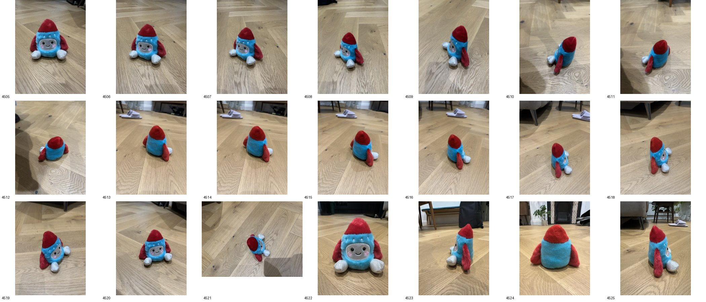

# 0002 — Reference dataset: plush rocket toy

- **Date:** 2026-11-04
- **Status:** done
- **Stage(s):** data
- **Git commit:** see repo history

## Question / hypothesis
What does a typical real input look like, and which pipeline assumptions does it break?

## Setup
- Source: `~/Downloads/toy/jpg`, copied into `data/toy/images/` (raw images are gitignored) and into `~/ComfyUI-Shared/input/toy/`.
- Capture: 21 photos, iPhone 14 Pro, 4032×3024 JPEG (converted from HEIC), taken over about 40 s on 2026-11-03.
- Contact sheet: 

## Results / observations

**Object**
- A plush toy shaped like a rocket: blue fuzzy body, red cone and three red fins, white feet, embroidered face with pink cheeks.
- About 15–20 cm tall, on a herringbone oak parquet floor.

**Coverage**
- A full 360° orbit at a high oblique angle (IMG_4505–4520).
- One almost top-down shot (4521).
- Four low, ground-level shots (4522–4525: front, side, back, side).
- The underside is never visible (the toy sits on the floor), so it can't be reconstructed. It needs completion or is accepted as a hole.

**Cameras: mixed lenses**
- 13 + 1 photos use the main camera (6.86 mm); 7 use the ultra-wide (2.22 mm): 4505–4507 and 4522–4525.
- EXIF reports a **24 mm equivalent for both**, so the ultra-wide frames are probably a crop: iPhone's macro/low-light switching.
- Consequences:
  - intrinsics differ between photos;
  - lens distortion profiles differ;
  - ultra-wide frames are softer.
- **The pipeline must not assume one shared intrinsics matrix.**

**Orientation**
- 20 images have EXIF Orientation = 6 (stored rotated 90°); one has Orientation = 1.
- **We must apply the EXIF rotation consistently** before anything else.
- ComfyUI's loaders apply it, but our own scripts (e.g. PIL) have to call `exif_transpose`.

**Exposure**
- ISO ranges from 320 to 1000, with exposure time fixed at 1/50 s, so brightness varies between photos.
- Texture blending needs exposure compensation, otherwise seams appear.

**Appearance challenges**
- The fuzzy fur has soft, ill-defined silhouettes. Mask edges will be uncertain and depth at the boundary noisy.
- The fur has view-dependent sheen.
- The large uniform blue and red areas have little texture to match. The embroidered face, feet and seams are the main features on the object itself.

**Background**
- The parquet is strongly textured, which is good for camera estimation.
- Some frames include other objects (slippers, chair legs, a radiator, a bag, a plant).
- The photographer's shadow appears in 4512 and 4521.
- The floor plane is a useful geometric prior: it gives the "up" direction, and lets us cut the object at the contact plane.

## Conclusion
This is a good, realistic capture. It's harder than an ideal one in four ways:
1. mixed intrinsics;
2. EXIF rotation;
3. exposure changes;
4. fuzzy, weakly textured material.

The toy is the **primary real test case**. Success criterion: the GLB, viewed from any input camera, looks like the toy, with **correct colours and placement** of the face, cheeks, red fins and cone, and white feet.

## Next
- Run DA3 multi-view on all 21 photos (fp32). Check the memory/time on MPS and whether the poses form a plausible orbit.
- Compare the DA3 intrinsics for main-camera versus ultra-wide frames against the EXIF focal length.
- Later: a cleaner capture protocol for comparison (single lens, locked exposure).
