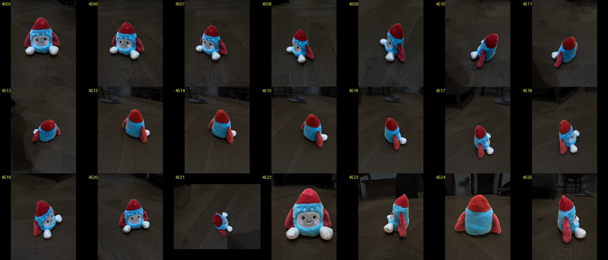
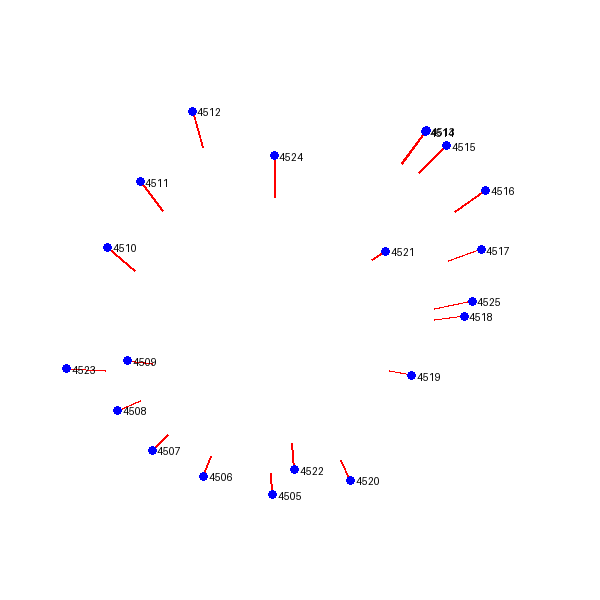
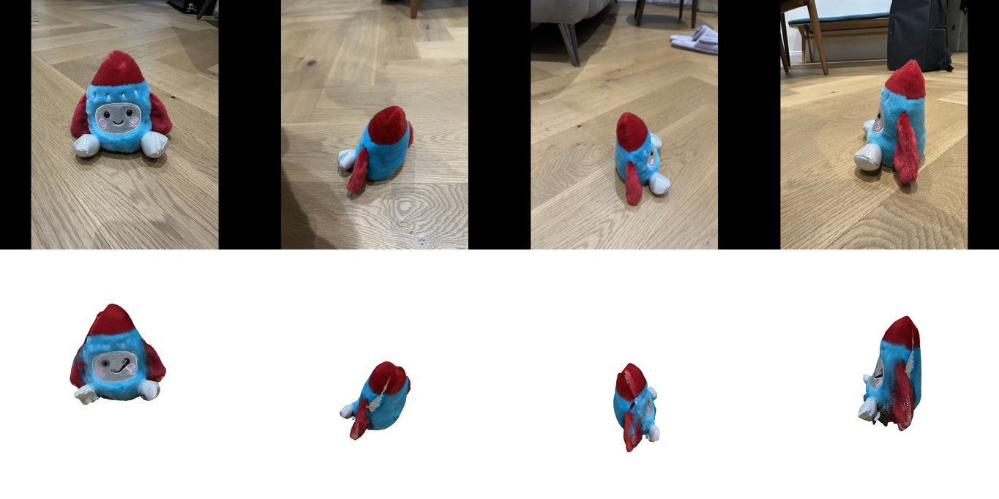

# 0003 — Pipeline v0: photos → coloured mesh (voxel carving)

- **Date:** 2026-11-04
- **Status:** done (offline). The in-ComfyUI run is pending a Desktop restart; see 0004.
- **Stage(s):** A, B, C, D (simplest version of each), infra
- **Git commit:** the commit that adds this entry
- **Builds on:** #0001, #0002

## Question / hypothesis
Can the simplest chain of native nodes plus one reconstruction node turn an arbitrary photo folder into a mesh whose colours match the object?

The chain:
- BiRefNet masks;
- DA3 multi-view (cameras + depth);
- voxel carving;
- surface nets;
- per-vertex colours from the photos.

Expected: a recognisable shape with correct colour placement, but blobby, because carving with soft fur masks and ~500 px depth is coarse.

## Setup
- Dataset: `data/toy` (21 photos), loaded at max side 1024 and padded to 1024×1024 (mixed portrait/landscape).
- Masks: native `LoadBackgroundRemovalModel` (birefnet) + `RemoveBackground`.
- DA3: Base, fp32, resolution 504, `cam_dec`, `saddle_balanced` reference view.
- Reconstruction (`ysda3d/recon.py`):
  - voxel grid of 192 along the longest axis, over the 2–98% quantile bounds of fused masked points, expanded by 15%;
  - a voxel is free if it projects outside the mask, or more than 0.02·diag in front of the observed depth;
  - a voxel is kept if at most 1 view says "free" and it is seen by at least 3 views;
  - 3×3×3 box blur, then surface nets at 0.5 (ComfyUI's `_surface_nets`), keeping the largest component;
  - colour: weighted average over the views where the vertex is visible (in mask, within 4 voxels of the observed depth), weight = cos(normal, view)².
- Scripts:
  - `scripts/run_da3_offline.py` runs the native nodes outside the server and saves an npz;
  - `scripts/reconstruct_offline.py` builds the mesh and renders render-vs-photo sheets;
  - `scripts/inspect_da3.py` checks masks and cameras.
- Workflow for Desktop: `workflows/photos_to_mesh_v0.ui.json`.

## Results

**Masks** are clean in all 21 views, including fins, feet, and the ground-level and top-down shots. 

**Cameras** form a plausible orbit in shooting order: 4521 (top-down) sits near the centre, and the low shots 4522/4524 are at the front/back. 

**Intrinsics:**
- DA3 estimates f ≈ 28 mm-equivalent for *all* views, against 24 mm in EXIF. That's 15% long, but consistent.
- It doesn't distinguish the main and ultra-wide frames, which is consistent with both being 24 mm-equivalent crops.

**Reconstruction:**
- 104k fused points, a 192×135×145 grid, a mesh of 65k vertices / 130k faces;
- 72% of vertices are directly seen; the rest (the underside) get the nearest colour;
- 1.8 s after DA3.

**Appearance:** from the input cameras, the shape and colour placement are correct: face with eyes, smile and pink cheeks, red cone and fins, white feet. 

**Defects:**
- the silhouette is blobby and slightly shrunken;
- thin white streaks on the fins and side;
- the bottom-left foot is ragged;
- colours are a bit soft (multi-view averaging).

**Timing (offline, M3 Max):** background removal ≈ 9.5 s/photo (196 s total, the bottleneck); DA3 for 21 views 6.6 s; reconstruction 1.8 s.

## Findings worth remembering

1. **DA3 OOM on MPS with many views.**
   - ComfyUI gives DINOv2 (DA3's backbone) and DA3's camera head `attention_basic` ("small input"), which materialises the full token×token matrix.
   - 21 views × 1296 tokens needed a 33 GB allocation and failed.
   - The Desktop server would crash the same way.
   - Fix: `ysda3d/comfy_compat.memory_efficient_da3_attention()` swaps in `attention_sub_quad` during the call. It's used by the node **YSDA Depth Anything 3 Multiview**.
2. **DA3 intrinsics are at the processing resolution (≈504 px)**, while its depth maps are upsampled to the input size. They must be rescaled before unprojecting (`recon.rescale_intrinsics`). ComfyUI's own `DA3GeometryToMesh` seems not to do this.
3. **Calling native nodes outside the server needs `torch.set_grad_enabled(False)`.** Otherwise outputs carry autograd graphs, memory grows, and the process is SIGKILLed.
4. ComfyUI's folder picker (`LoadImageDataSetFromFolder`) ignores symlinked folders, so datasets are copied into `input/`. Custom-node loading *does* follow symlinks.
5. OpenCV → glTF axes, $(x,-y,-z)$, is a rotation (det +1), so no winding flip is needed.

## Conclusion
The hypothesis is confirmed: v0 produces a recognisable mesh with correctly placed colours from arbitrary handheld photos, using only native models plus about 300 lines of our code.

## Next
- 0004: run the same pipeline inside Comfy Desktop (after a restart) to confirm the nodes load and the GLB previews.
- Quality backlog, ordered by expected gain:
  - **sharper colours:** best-view or top-2 weighting instead of a broad average; exposure compensation;
  - **less shrinkage:** max_violations as a fraction of seen views; dilate masks slightly for the soft fur edge;
  - **streaks:** drop colour samples near mask edges and depth discontinuities;
  - **detail:** higher DA3 resolution (756/1008); bundle adjustment (v2 in the plan);
  - **speed:** background removal at lower resolution, or batched.
- Add held-out-view metrics (PSNR/ΔE), so improvements are measured, not eyeballed.
