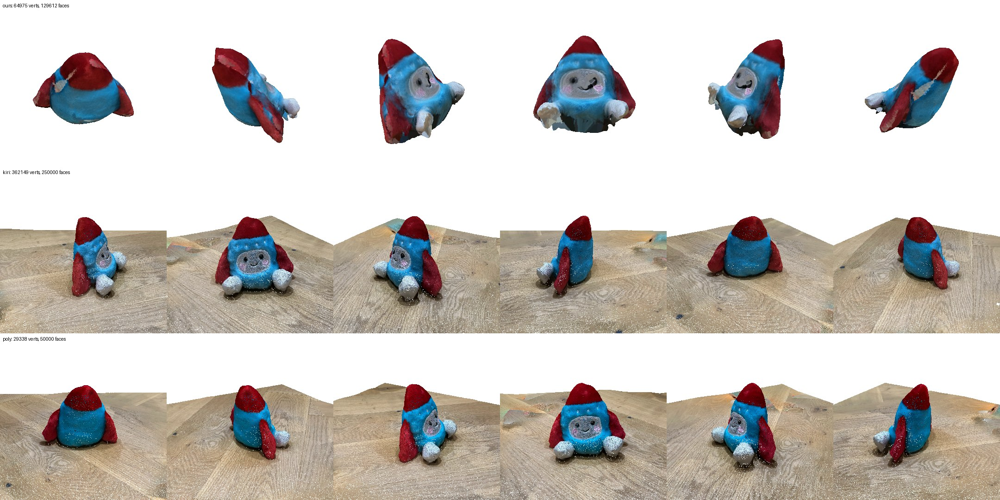
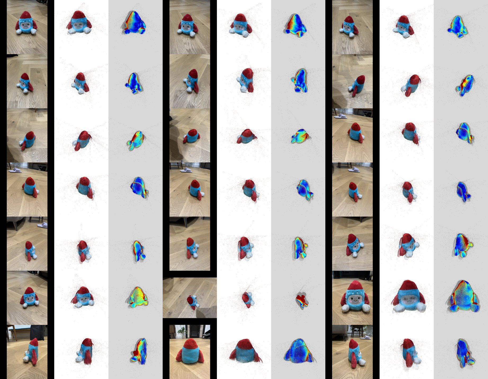
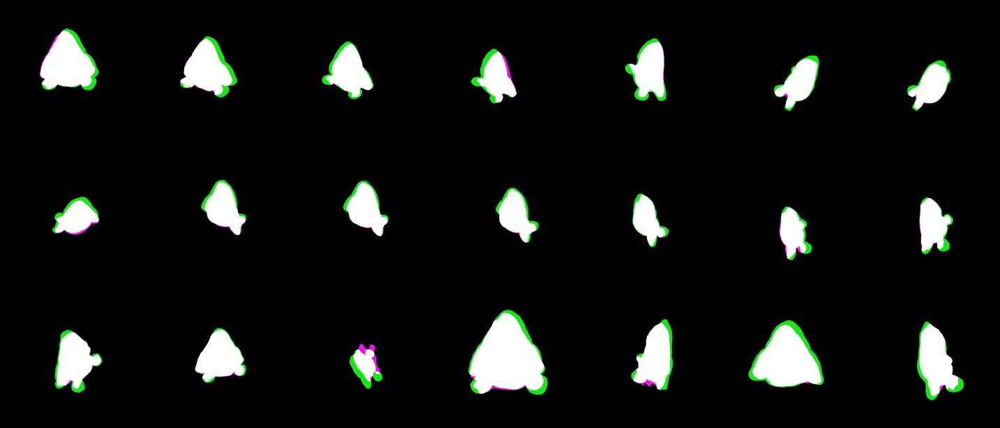
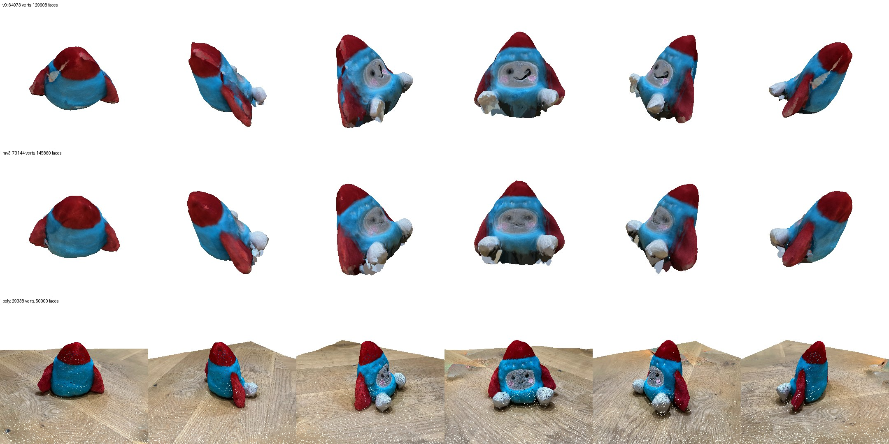

# 0004 — Where does v0 lose quality? Per-stage diagnostics vs KIRI / Polycam

- **Date:** 2026-11-06
- **Status:** done
- **Stage(s):** A, B, C, D (diagnostics), infra
- **Git commit:** the commit that adds this entry
- **Builds on:** #0003

## Question / hypothesis
v0 is clearly worse than KIRI and Polycam on the same 21 toy photos. Which stage is responsible?

Hypothesis: **B (DA3 camera poses / depth)**. Small misalignments between views would make carving (an intersection over views) shave the shape, and make colour averaging blur.

## Setup
- References: KIRI (`~/Downloads/toy_kiri`, OBJ, 125k vertices / 250k faces, 2048² texture) and Polycam (`~/Downloads/toy_poly.glb`, 29k / 50k, textured).
- All three rendered from the same 6-view orbit with `scripts/render_compare_models.py`.
- New diagnostics (`ysda3d/diagnostics.py`, nodes in the pack; offline: `scripts/diagnose_offline.py`):
  - **A. Mask overlay** on every photo.
  - **B1/B2. DA3 depth / confidence** per photo.
  - **B3. Cross-view consistency.** Project the masked 3D points of all *other* views into view i, and compare their depth with view i's depth inside the mask. Report the median relative error and the fraction above 2%. Tile = [photo | others rendered here | disagreement heatmap].
  - **B4. Fused point cloud** with cameras (PLY).
  - **C. Silhouette check.** Render the mesh outline into each view, compare with the mask (IoU); green = carved away, magenta = extra.
- Experiments: each changes one thing. Masks are reused via `run_da3_offline.py --masks-from`.

## Results

**Ours vs references** (references zoomed ×3; they keep a patch of floor): 

KIRI and Polycam have:
- a crisp cone and 3 separate fins;
- distinct feet;
- a sharp face, cheeks and stitching;
- an upright orientation.

Ours is blobby, the fins are merged or shaved, the texture is soft with red bleeding onto blue, and the model is tilted (our world frame is the DA3 reference camera).

The white speckles on the references are gaps in my quick renderer, not holes in their models. A first render showed their textures scrambled; that was my bug (I flipped V, but ComfyUI's MESH UVs already use glTF's top-left origin).

**Stage A (masks):** clean in all 21 views. **Not the bottleneck.**

**Stage B (DA3): the bottleneck.**
- Cross-view depth disagreement: median **1.8%** of depth (≈3% of the toy's size); per view 0.8–6.2%; 25–90% of overlapping pixels exceed 2%.
- The heatmaps show *structured* errors (whole regions shifted, gradients), i.e. pose or scale errors, plus flying points at the fur silhouettes. 
- Worst view: **IMG_4521** (top-down, the only landscape photo): 6.2% error, IoU 0.52.

**Stage C (carving):** systematic shrinkage. A green rim appears in almost every view; mean IoU **0.813**. 

**Stage D (colour):** blurred by averaging misaligned views. It inherits B's error.

**Experiments**

| Variant | Median cross-view depth error | Mean silhouette IoU |
|---|---|---|
| v0 baseline (cam_dec, 504, max_violations=1) | 1.83% | 0.813 |
| max_violations = 3 | 1.83% | **0.852** |
| drop IMG_4521 | 1.93% | 0.828 |
| pose_method = ray_pose | 1.80% | 0.825 |
| DA3 resolution 756 | 1.85% | 0.704 |

- max_violations = 3 gives a fuller shape (fins and cone recovered) but a **blurrier face**. 

## Conclusion
The hypothesis is confirmed.
- **DA3's feed-forward poses and depth are consistent across views to only about 1.8%.**
- No DA3 setting changes that (pose method, resolution, dropping the worst view).
- Carving turns the disagreement into lost volume, and colour averaging turns it into blur. Loosening carving trades shape against sharpness, so it's not a fix.
- KIRI and Polycam refine their cameras with bundle adjustment on full-resolution photos. That's the missing piece.

## Next
1. **Pose refinement (plan iteration v2): the highest-expected-gain change.**
   - Match features on full-resolution photos with pycolmap (SIFT; LightGlue later).
   - Initialise from DA3's poses and intrinsics.
   - Bundle-adjust with per-camera intrinsics; the toy set mixes two lenses.
   - Success metric: cross-view depth error well below 1%, IoU > 0.9, a visibly sharper face.
2. **Surface from fused depth (TSDF/Poisson) instead of a hard intersection.** Averaging is robust to residual misalignment; keep carving only to trim outside the visual hull.
3. **Colour from the single best view per region** (later: MRF view selection plus seam leveling) instead of a broad average.
4. **Upright orientation:** fit the floor plane (DA3 depth outside the mask) and use its normal as "up".
5. DA3 at higher resolution is *not* helpful (IoU 0.70); don't retry without a reason.
