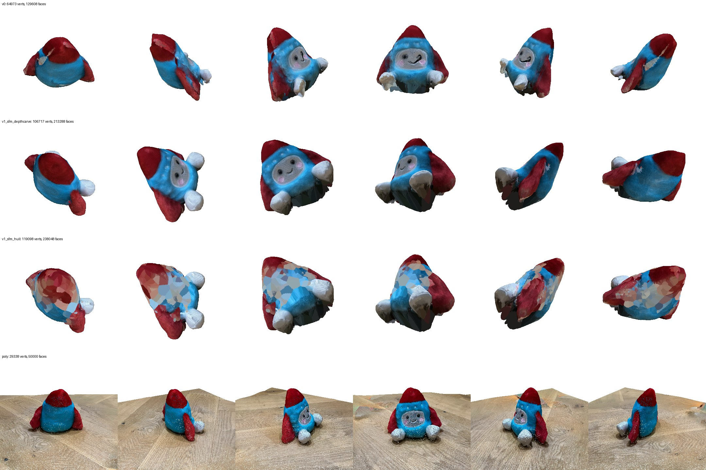
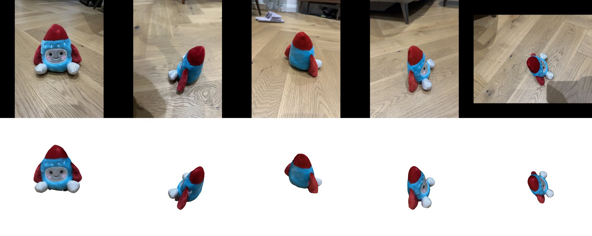

# 0005 — v1: COLMAP camera refinement (bundle adjustment) instead of DA3 poses

- **Date:** 2026-11-06
- **Status:** done offline; the in-ComfyUI run is pending a Desktop restart (the new node isn't loaded yet)
- **Stage(s):** B (cameras), infra
- **Git commit:** the commit that adds this entry
- **Builds on:** #0004 (bottleneck = DA3 cross-view inconsistency)

## Question / hypothesis
If we replace DA3's feed-forward cameras with COLMAP SfM, do the views agree, and does the model become sharper?

COLMAP here means SIFT on 1600 px photos, exhaustive matching, incremental mapping and bundle adjustment. Expected: cross-view error well below DA3's 1.8%, silhouette IoU above 0.9, and a sharper face.

## Setup
- `ysda3d/sfm.py` (orchestration) and `ysda3d/sfm_worker.py` (pycolmap 4.2.1, **subprocess**).
- Photos: EXIF-rotated, resized to 1600 px, grouped into folders by **lens and image size**, with one COLMAP camera per folder (`CameraMode.PER_FOLDER`), model SIMPLE_RADIAL.
- SfM cameras are mapped into the 1024² padded canvas: scale + offset of K; k1 is unchanged, since normalised coordinates don't change with resizing.
- DA3 depth is **rescaled per photo**: the median of z_SfM / z_DA3 over SfM points inside the object mask dilated by 8% of the image.
- **Registration checks:** reject photos with fewer than 200 triangulated points, or whose rotation disagrees with DA3's by more than 10° (after aligning the DA3 frame to the SfM frame on the strong views).
- Rejected and unregistered photos are **dropped** (`drop_unregistered=True`); keeping them with DA3 poses was measured and is worse.
- **Radial distortion (k1)** is now modelled in every projection and unprojection (`recon.project`, `undistort_normalized`, renderer, diagnostics).
- ComfyUI: node **YSDA Refine Cameras (COLMAP)**, workflow `workflows/photos_to_mesh_v1_colmap.ui.json` (Desktop: `ysda_photos_to_mesh_v1_colmap`), with consistency diagnostics before and after.

## Results

**COLMAP:**
- 19/21 photos registered, 6.2k points, **0.72 px** mean reprojection error;
- 3 cameras: ultra-wide portrait f = 1097 px, main portrait 1186 px, main landscape 1127 px (at 1600 px); k1 ≈ −0.044 / −0.038.
- 4524/4525 (low ultra-wide) didn't register.
- 4522/4523 registered **wrongly**, from only 78/139 points, mostly background ([overlay](assets/0005_bad_registration_overlay.jpg)). Their rotations differed from DA3's by only 7.1° and 2.6°, so the point-count rule is what catches them. Final: **17 photos kept**.

**Bugs found along the way (each verified, then fixed):**
1. pycolmap and torch bundle two OpenMP runtimes, and importing both aborts the process. The same would happen inside the ComfyUI server, so COLMAP runs in a subprocess using the venv's python (`sys.prefix/bin/python3`, since `sys.executable` may be the base interpreter).
2. One COLMAP camera per folder assumes one image size; the single landscape photo didn't register until groups became lens + size.
3. A per-view depth scale fitted on *all* SfM points made things worse (4513–4516: 16% error). Those views see far background, and DA3's depth error isn't a single global scale, so the fit was restricted to points near the object.
4. Pinhole projection of COLMAP's points was off by 1.5–8 px (canvas) because of radial distortion; with k1 it's 0.3–0.8 px. Distortion is now modelled everywhere.
5. (Test bug, not pipeline.) Comparing poses against a *later* COLMAP run gave a fake 80 px error: every run has its own gauge.

**Metrics** (all 21 views for DA3; the 17 kept views for COLMAP):

| Cameras | Surface | Cross-view depth err | Silhouette IoU |
|---|---|---|---|
| DA3 (v0) | carve: masks + DA3 depth | 1.83% | 0.813 |
| COLMAP, all points for depth scale | carve: masks + depth | 3.56% | 0.770 |
| COLMAP + near-object scale | carve: masks + depth | 1.48% | 0.825 |
| + dropping bad registrations (**v1**) | carve: masks + depth | **1.42%** | **0.895** |
| v1 cameras | masks only (visual hull, 1 violation) | — | 0.933 |
| v1 cameras | masks only, strict | — | **0.956** ([sil](assets/0005_strict_hull_colmap.jpg)) |

- The strict visual hull reproducing the masks at 0.956 shows that the **cameras are now accurate**. DA3's depth (still 1.4% inconsistent) is the weaker input.

**Visual** (rows: v0, v1, v1 visual hull, Polycam): 
- v1 is **much sharper**: eyes, smile, pink cheeks, even the stitched dots; distinct feet; no red bleeding. Photo-vs-render: 
- The visual-hull variant has the best shape, but **patchy colours**: only 35% of vertices are "seen". Visibility is tested against DA3 depth, which the hull surface doesn't match, so most vertices get nearest-neighbour colours.
- Orientation is still arbitrary (COLMAP's gauge), and the underside is unobserved (dark).

**Timing:** refinement ≈ 64 s for 21 photos (CPU SIFT + matching at 1600 px).

## Conclusion
The hypothesis is confirmed: bundle-adjusted cameras fix most of v0's blur and much of its shrinkage.
- Remaining limits: DA3 depth consistency (1.4%) and the 4 dropped ground-level photos (less coverage of the lower parts).
- **Default v1:** COLMAP cameras + carving with masks and DA3 depth, max_violations 1, depth_tol 0.02.

## Next
1. **Colour visibility from the reconstructed surface itself** (z-buffer of the mesh), not from DA3 depth. That would unlock the visual-hull / mask-dominant surface, which has the better shape (0.956 IoU).
2. **Surface:** TSDF/Poisson fusion of the *rescaled* DA3 depths with v1 cameras, trimmed by the visual hull. Compare with carving.
3. **Recover the low photos:** register 4522–4525 by PnP against the SfM points, or with learned matching (LightGlue) via the DA3 initialisation.
4. **Upright orientation** from the floor plane (SfM points outside the mask).
5. Speed: SIFT at 1600 px is fine (≈1 min); don't optimise yet.
