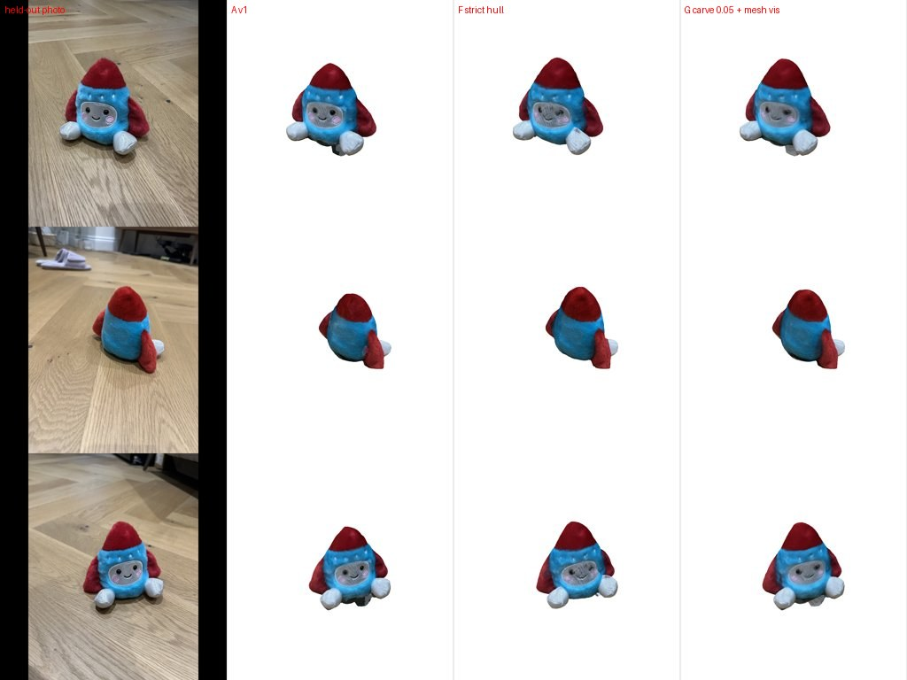
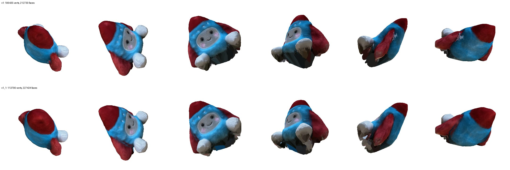

# 0007 — v1.1: colour visibility from the mesh itself (z-buffer) + looser depth carving

- **Date:** 2026-11-07
- **Status:** done offline; the in-ComfyUI run is pending a Desktop restart (new node)
- **Stage(s):** C (surface), D (colour), evaluation
- **Git commit:** the commit that adds this entry
- **Builds on:** #0005 (next step 1: mesh-based visibility)

## Question / hypothesis
In v1, visibility for colouring was tested against **DA3 depth**. That works only if the surface matches DA3's depth, which made the better-shaped visual hull (IoU 0.956) unusable: patchy colours, only 35% of vertices "seen".

Hypothesis: testing visibility against the **mesh's own z-buffer** makes colouring independent of DA3 depth, so we can use a fuller surface and beat v1 on photos the method didn't see.

## Setup
- New code in `ysda3d/recon.py`:
  - `surface_samples`, `zbuffer` (`scatter_reduce` amin + 3×3 hole fill), `mesh_depth_maps`, `erode_masks`;
  - `reconstruct(visibility="mesh", color_power, mask_erode_px)`.
- New metric in `ysda3d/diagnostics.photometric_check`, rendering the vertex-coloured mesh into given photos:
  - `psnr` = PSNR over mask ∩ render;
  - **`psnr_full_mask`** = PSNR over the whole mask (uncovered = white background), comparable across methods because holes and shrinkage are penalised.
- **Held-out protocol** (`scripts/eval_variants.py`): from the 17 COLMAP-registered toy photos, IMG_4506, 4513 and 4520 (spread around the orbit) are left out of reconstruction and used only for evaluation.
- Cameras / depth: `outputs/toy_sfm.npz` (v1 refinement).

## Results (held-out photos)

| Variant | Surface | Visibility | Colour weight | PSNR full-mask | PSNR covered | Coverage | Sil. IoU |
|---|---|---|---|---|---|---|---|
| A (= v1) | carve, depth_tol 0.02 | DA3 | cos² | 13.69 | 20.14 | 0.929 | 0.883 |
| B | carve 0.02 | mesh | cos² | 13.74 | **20.46** | 0.929 | 0.884 |
| C | hull (1 violation) | mesh | cos² | 17.14 | 17.84 | 0.996 | 0.905 |
| D | hull | mesh | cos⁶ | 16.98 | 17.62 | 0.996 | 0.906 |
| E | hull | mesh | cos⁶, erode 3 px | 16.97 | 17.61 | 0.996 | 0.906 |
| F | strict hull | mesh | cos⁶, erode 3 | **17.41** | 18.43 | 0.993 | **0.952** |
| **G (= v1.1)** | **carve, depth_tol 0.05** | **mesh** | **cos²** | **17.39** | **19.44** | 0.984 | 0.920 |
| H | carve 0.05 | mesh | cos⁵⁰ (≈best view) | 16.65 | 18.43 | 0.984 | 0.920 |
| I | strict hull | mesh | cos⁵⁰ | 16.80 | 17.70 | 0.993 | 0.952 |
| J | carve 0.02 | mesh | cos⁵⁰ | 13.62 | 19.76 | 0.929 | 0.884 |
| K | carve 0.05, strict | mesh | cos⁵⁰ | 12.97 | 18.77 | 0.923 | 0.907 |

Held-out photo vs renders (A = v1, F, G = v1.1): 

Full model (17 photos), v1 vs v1.1 from the same orbit: 

## Observations
- **The covered-pixel PSNR was misleading.** Depth carving (A/B/J) scores well only on the 93% of the mask it covers. Its shrinkage (clipped fins and feet, cut bottom) is invisible to that metric. Full-mask PSNR exposes it: 13.7 vs 17.4 dB.
- Mesh visibility alone (B vs A) helps a little (+0.3 dB covered).
- Looser surfaces (hull, or carve 0.05) **need** mesh visibility, and together they give **+3.7 dB** full-mask on held-out photos.
- **Sharper weighting doesn't help.** cos⁶ is neutral; cos⁵⁰ "best view" hurts (−0.7 to −0.8 dB). Weights underflow (seen fraction ~0.43), so more vertices fall back to nearest-neighbour colours, and seams appear.
- Mask erosion (3 px) is neutral.
- **Remaining issue:** the face is slightly softer in v1.1 than in v1. Where the toy is concave (face region) the looser surface sits a bit in front of the true surface, so neighbouring photos project to slightly different places and averaging blurs. v1's tighter carve fits the face better but loses the silhouette.

**All 17 photos with v1.1 (node test):** silhouette IoU 0.945 (v1: 0.896), 71% of vertices directly seen.

## Conclusion
The hypothesis is confirmed. v1.1 = COLMAP cameras + carving with depth_tol 0.05 + **mesh z-buffer visibility** + cos² weighting.
- It's better than v1 on held-out photos: full-mask PSNR 13.7 → 17.4 dB, IoU 0.88 → 0.92.
- Visually: a fuller shape with fewer artifacts, and a slightly softer face.
- Don't retry: best-view (very high power) weighting; mask erosion for this toy.

## Artifacts
- Node **YSDA Reconstruct Mesh (v1.1)**.
- Workflow `workflows/photos_to_mesh_v1_1.ui.json` (Desktop: `ysda_photos_to_mesh_v1_1`).
- Model `models/toy/v1_1_meshvis.glb` (17 photos, produced offline with the node code).

## Next
1. Fix face softness with a better surface in concave regions: fuse DA3 depths (rescaled, COLMAP cameras) by TSDF *inside* the hull, rather than carving; or per-view small 2D alignment before blending.
2. Exposure / white-balance compensation per photo.
3. Upright orientation from the floor plane.
4. (Main track) v2 with UniForge3D once DINOv3 access arrives: 04_plan_v2.
