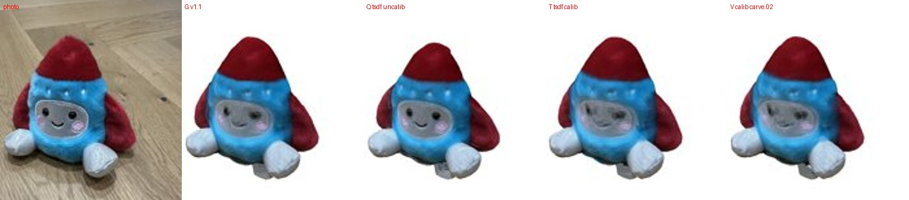
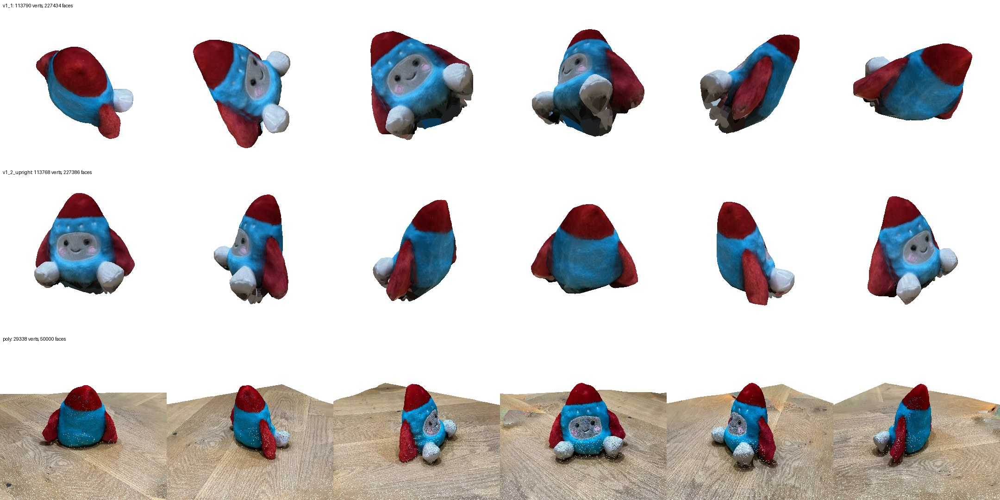

# 0008 — v1.2: TSDF depth fusion inside the hull (negative result) + upright orientation

- **Date:** 2026-11-09
- **Status:** done. TSDF: not adopted (kept as an option). Upright: adopted. The in-ComfyUI run is pending a Desktop restart (new node).
- **Stage(s):** C (surface), output frame
- **Git commit:** the commit that adds this entry
- **Builds on:** #0007 (next step 1: better surface in concave regions; next step 3: upright)

## Question / hypothesis
1. **Surface.** v1.1's carved surface sits slightly in front of the true surface where the toy is concave (the face), so neighbouring photos project to slightly different places and the face softens. Hypothesis: TSDF fusion of the (rescaled) DA3 depths *inside* the mask hull (Curless & Levoy) places concave regions better, sharpening the face without losing v1.1's silhouette.
2. **Orientation.** The output frame was arbitrary (the COLMAP gauge). Hypothesis: a RANSAC plane through depth points around the mask gives the floor reliably, so up = floor normal and front = the anchor (first) photo.

## Setup
- `recon.tsdf_in_hull`:
  - per voxel inside the hull: confidence-weighted mean of clamp((d−z−bias)/trunc, ±1) over views that see the voxel inside the mask with sdf > −trunc;
  - unobserved hull voxels = interior; outside the hull = empty.
- Options:
  - truncation (3/5/8 voxels);
  - mask-edge down-weighting (`edge_weight`, 25/60/100 px);
  - outward bias (2–3 voxels);
  - **per-view depth calibration against the hull's own depth** (median z_hull/z_DA3 over the eroded mask).
- `recon.floor_plane` (RANSAC in a 15–80 px ring around each mask, least-squares refit, normal oriented towards the cameras); `upright_frame` (rows: right, up, front; front = anchor camera direction projected on the floor); `to_display_upright` (on y = 0, centred in x/z).
- The same held-out protocol as 0007: 4506/4513/4520 left out of 17 COLMAP-registered photos (`scripts/eval_variants.py`).

## Results — surface (held-out)

| Variant | PSNR full-mask | PSNR covered | Coverage | IoU |
|---|---|---|---|---|
| **G = v1.1** (carve 0.05) | 17.39 | 19.44 | 0.984 | 0.920 |
| L TSDF t=5 | 11.59 | 19.66 | 0.877 | 0.842 |
| M TSDF t=3 | 10.74 | 18.88 | 0.844 | 0.816 |
| N TSDF t=8 | 12.23 | 20.16 | 0.893 | 0.857 |
| O TSDF in strict hull | 11.55 | 19.67 | 0.876 | 0.873 |
| P TSDF + edge weight 25 px | 11.64 | 19.72 | 0.880 | 0.841 |
| Q TSDF + bias 3 | 14.08 | **20.62** | 0.933 | 0.889 |
| R TSDF t=8, edge 25, bias 3 | 13.92 | 20.59 | 0.930 | 0.884 |
| Y / Z TSDF + bias 3 + edge 60 / 100 | 13.74 / 14.31 | 20.41 / 20.20 | 0.929 / 0.941 | 0.878 / 0.886 |
| S TSDF + **hull calibration** | 17.35 | 19.16 | 0.987 | 0.916 |
| T TSDF + calibration + bias 2 | 17.57 | 18.75 | 0.993 | 0.914 |
| U TSDF t=8 + calibration | 17.41 | 18.96 | 0.989 | 0.917 |
| V calibration + carve 0.02 | **17.61** | 18.83 | 0.992 | 0.917 |
| W / X calibration + carve 0.03 / 0.05 | 17.61 / 17.56 | 18.67 / 18.49 | 0.994 / 0.995 | 0.916 / 0.914 |

Face close-up (held-out IMG_4506): 

## Observations
- **Plain TSDF shrinks the object uniformly** (coverage 0.84–0.89). Edge down-weighting doesn't help, so it's not caused by fuzzy mask edges.
- **Hull calibration** shows why: every factor is **0.94–0.975**, i.e. after the v1 rescaling (fitted on SfM points *near* the object, mostly floor) DA3's depth sits **~4% too far**.
- Calibration fixes the shrinkage (coverage 0.99, ≈ v1.1 numbers), **but brings back ghosting** (doubled eyes) in the concave face. The hull is in front of the true surface there, so a median scale fitted to the hull pulls the face forward again.
- The **sharpest face is Q** (uncalibrated TSDF + bias), whose surface lies *behind* the hull in the face region. But Q loses the silhouette elsewhere.
- So, per photo, DA3's depth is roughly right in the centre of the object and wrong near its outline (grazing surfaces). No single fused surface satisfies all photos at once. The best full-mask numbers stay within +0.2 dB of v1.1 (17.61 vs 17.39), which is not significant with 3 held-out photos.

## Results — upright
- Floor normal within **9.6°** of the mean camera up-vector; all 17 cameras above the floor (heights 3.3–6.6 units); 48% RANSAC inliers (the ring also catches other objects).
- The output now stands on y = 0 with the cone up and the face towards +Z (anchor IMG_4505 = front view), directly comparable with Polycam: 

## Conclusion
- **Surface hypothesis rejected:** TSDF inside the hull trades silhouette against face sharpness and never beats v1.1 overall. It's kept as `surface_mode="tsdf_in_hull"` and `calibrate_depth` for experiments, off by default.
  - **Do not retry** without new depth: edge weighting, more truncation, or a global per-view scale.
  - What's left (per-region depth errors) needs either *per-region* correction or a prior that knows shapes, which is the v2 direction.
- **Upright adopted:** v1.2 = v1.1 + floor-plane upright output.

## Artifacts
- Node **YSDA Reconstruct Mesh (v1.2, upright)** (inputs: upright, surface_mode, calibrate_depth).
- Workflow `workflows/photos_to_mesh_v1_2.ui.json` (Desktop: `ysda_photos_to_mesh_v1_2`).
- Model `models/toy/v1_2_upright.glb` (17 photos, produced offline with the node code).

## Next
1. Per-view 2D alignment before colour blending (optical-flow-style warp of each photo onto the mesh render); attacks face ghosting directly, without changing geometry.
2. Exposure / white-balance compensation per photo.
3. Main track (v2): UniForge3D once DINOv3 access is granted (04_plan_v2). Its shape prior is exactly what fixes per-region depth errors.
