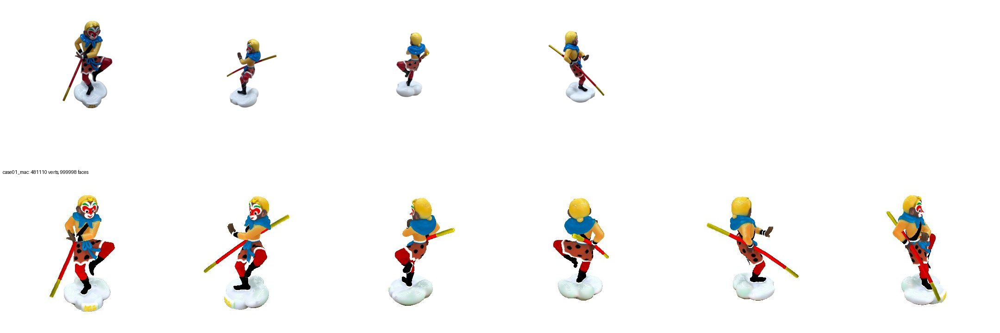

# 0009 — v2.0: UniForge3D running on Apple Silicon (MPS)

- **Date:** 2026-11-09
- **Status:** done (port). The toy runs follow in 0010.
- **Stage(s):** G (generator), infra
- **Builds on:** #0006 (study), plan `04_plan_v2_recon_plus_generation.md` v2.0

## Question
Can the official UniForge3D inference (CUDA-only reference code) run on the M3 Max without modifying its source or retraining?

## Setup
- Code `~/src/UniForge3D` @8b60947 (unmodified); weights `xibushu/UniForge3D` + TRELLIS.2-4B / TRELLIS-image-large ckpts (HF cache); DINOv3-L from `~/Downloads/dinoV3` (user-provided).
- Separate venv `~/src/uniforge3d-venv`: Python 3.12, torch 2.15 (MPS), transformers 4.57.3, peft 0.17.1, trimesh, fast-simplification.
- Port in the repo: `v2/uniforge_mac/` (README there).
  - **Stand-in modules**, injected first on `sys.path`:
    - `flash_attn`: SDPA, query-chunked;
    - `flex_gemm` submanifold conv: hash-map neighbours identical to ComfyUI's TRELLIS.2 port; fp32 matmul;
    - `flex_gemm` `grid_sample_3d`: cell-centre trilinear over occupied corners;
    - `o_voxel` flexible dual grid → mesh;
    - `cumesh` subset: QEM decimation + trimesh cleanup; hole filling and narrow-band remeshing skipped;
    - `nvdiffrast` placeholder.
  - **`patch.py`**:
    - autocast("cuda") → "mps"; no-op `torch.cuda.set_device`; `torch.segment_reduce` on CPU;
    - Shape-512 post-process → CPU decimation;
    - texture remesh/UV-bake → **per-vertex base colour sampled from the PBR voxels**;
    - VGGT conditioner forced to fp32;
    - no RMBG (inputs must be RGBA).

## Bugs found and fixed (in order)
1. `ModuleNotFoundError: cumesh`: the package imports every CUDA extension at load time, so all stand-ins must exist before import.
2. **Metal assertion** "Destination NDArray and Accumulator NDArray" in shape-512 (same message as DA3 in journal 0001).
   - The cause was *not* the sparse-conv matmul (moving it to fp32 didn't help).
   - It was the VGGT conditioner: weights bf16, autocast enabled only when `device.type == "cuda"`, so fp32 inputs went into bf16 Linear layers.
   - Fix: run the conditioner in fp32 (~4 GB).
   - `faulthandler` was essential for finding the Python frame behind a Metal abort.
3. `torch.segment_reduce` has no MPS kernel (used in the sampler's CFG rescale) → CPU round-trip.

## Results (authors' `assets/case01`, 4 clean RGBA renders)

| Stage | Time (M3 Max) |
|---|---|
| load models (27 GB, low-VRAM sequential) | 107 s |
| DINOv3 | 4 s |
| structure: joint VGGT+DiT, 12 steps | 61 s |
| shape 512, 20 steps (+ CPU decimation to 1M faces) | 60 s |
| shape 1024, 20 steps | 295 s |
| texture, 20 steps | 425 s |
| **total** | **954 s (~16 min)** |

- Complete and upright, faithful to the inputs: staff, mask colours, scarf, spotted trousers, cloud base, plausible back.
- 481k vertices / 1M faces, vertex colours.

## Conclusion
UniForge3D is usable on the laptop.

**Known differences from the CUDA path:**
- vertex colours instead of a baked 2048² UV texture (our v2.3 re-textures from photos anyway);
- no hole filling or narrow-band remeshing;
- fp32 VGGT conditioner (outputs should be numerically very close).

There's no CUDA reference output to compare against; the visual check on the authors' examples is the sanity test.

## Next
- 0010 (v2.1): real toy photos as RGBA (full-resolution photo + upsampled BiRefNet alpha), K = 4 / 8 views, anchor choice.
- Speed later: shape-1024 and texture dominate (≈12 min); options include fewer steps or skipping 1024 for previews.
