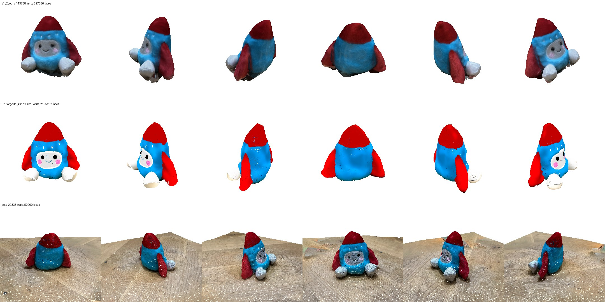
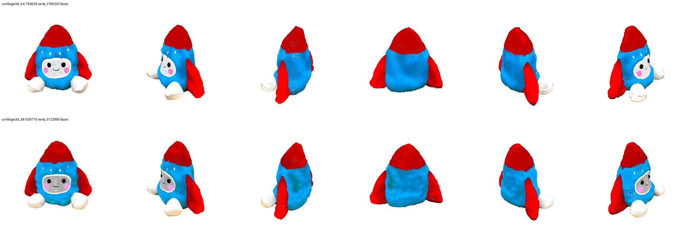

# 0010 — v2.1: UniForge3D on the real toy photos (K = 4, K = 8)

- **Date:** 2026-11-09
- **Status:** done
- **Stage(s):** G (generator), input adapter
- **Builds on:** #0009 (port), plan v2.1

## Question / hypothesis
Does UniForge3D (trained on clean synthetic renders) produce a complete, faithful model from our *real* handheld toy photos, given background-removed RGBA views?

Expected:
- complete, upright geometry, fixing the underside and the smeared back of v1.x;
- colours plausible but not photo-faithful (albedo prediction).

## Setup
- **Input adapter** `scripts/make_rgba_views.py`: full-resolution EXIF-rotated photo (3024×4032) + our BiRefNet mask, mapped from the 1024 canvas back to photo resolution (bilinear, soft alpha). The toy is then ~1000 px tall before UniForge3D's own square alpha-crop. A 1024-canvas input would have had the toy at ~300 px.
- Numbered file names fix the order; the first file is the anchor.
- **K = 4:** IMG_4505 (front, anchor), 4509, 4513 (back), 4518, i.e. ~90° apart around the high orbit.
- **K = 8:** 4505, 4507, 4509, 4511, 4513, 4515, 4518, 4520.
- Port from 0009; seed 42.

## Results — K = 4

**Timing:** structure 64 s, shape 512 111 s, shape 1024 589 s, texture 818 s; **total 28 min**. Twice case01's time, because the toy occupies more voxels.

**Output:** 794k vertices / 2.2M faces, vertex colours. Model `models/toy/v2_uniforge3d_k4.glb`.

Rows: our v1.2, UniForge3D K = 4, Polycam (same orbit): 

**Geometry, the best we have:**
- complete and upright;
- a crisp cone, three distinct fins, a clean back (v1.x smeared it), a closed body;
- the anchor's azimuth defines the front, as the paper describes.

**Face:** very sharp (eyes, smile, cheeks), with no ghosting. That's the problem v1.1/v1.2 couldn't fix (journal 0008).

**Colour:** saturated, flat "albedo" red and blue, a whiter face plate, no fur texture. Expected: the texture model predicts PBR base colour (lighting removed), and our renders are unlit. v1.x carries the photos' real shading and fur, so it's more photo-like in that sense.

**Defects:**
- gaps in the feet (hole filling skipped in the Mac port);
- sparse dark speckles (probably vertices sampling empty or low-alpha texture voxels);
- the mesh is heavy (2.2M faces; the decimation target applies before the 1024 stage).

## Results — K = 8
- **Timing:** structure 89 s, shape 512 122 s, shape 1024 653 s, texture 1014 s; **total 33 min**.
- **Output:** 930k vertices / 3.1M faces. Model `models/toy/v2_uniforge3d_k8.glb`.

K = 4 (top) vs K = 8 (bottom): 

- **More photo-faithful appearance with K = 8:**
  - the face plate is grey satin (as in reality; K = 4 made it white);
  - fur texture is visible on the blue body;
  - the feet are more complete.
- **Face features slightly softer** than K = 4 (more views to reconcile).
- Shape essentially the same.
- So the per-voxel routing does use the extra views. The model was trained with 4 views, but 8 real views still help appearance.

## Conclusion
UniForge3D gives the shape and completeness that pure reconstruction couldn't, and it works on real photos with our masks. Appearance faithfulness is the gap, which is plan v2.3 (re-texture observed regions from the registered photos).

## Next
1. Anchor ablation; K = all (21) to test the limit (memory/time).
2. v2.2: register the UniForge3D mesh into the COLMAP frame (silhouette / point-map alignment), then held-out evaluation with the same protocol as 0007/0008.
3. Fix port defects: hole filling (trimesh or our own), speckle filtering, final decimation to ~300k faces.
