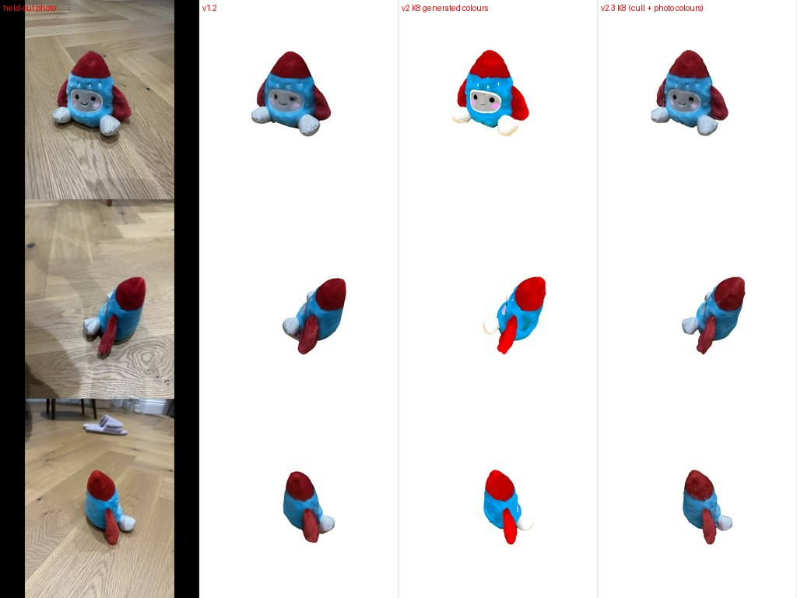
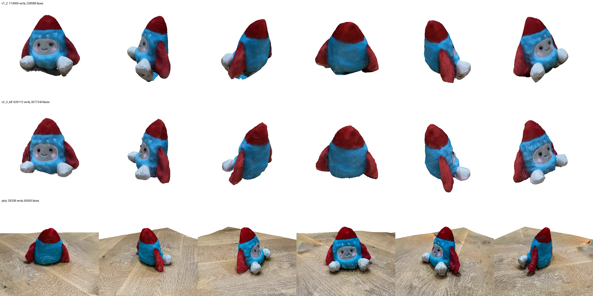

# 0012 — v2.2 + v2.3: register UniForge3D to the photos' cameras, colour it from the photos

- **Date:** 2026-11-09
- **Status:** done offline (node test); the Desktop run is pending a restart (new node)
- **Stage(s):** R (registration), T (appearance), evaluation, mesh repair
- **Builds on:** #0005 (COLMAP cameras), #0007 (mesh visibility), #0010 (UniForge3D on the toy), plan v2.2/v2.3

## Question / hypothesis
1. **v2.2.** Can the generated mesh (generator frame: +Y up, +Z = anchor) be brought into the COLMAP frame accurately enough that photos *not given to the generator* confirm its shape?
2. **v2.3.** Does colouring it from the real photos give v1.x-level colour fidelity, together with v2's complete, clean shape?

## Protocol
- Held-out photos **IMG_4506, IMG_4510, IMG_4516**: registered by COLMAP, and used by no method (not in UniForge3D's K = 4/K = 8 inputs; v1.2 rebuilt without them).
- 14 training photos. Same metrics as 0007/0008: full-mask PSNR, covered PSNR, coverage, silhouette IoU on held-out photos (`scripts/eval_v2.py`).

## Method
- **Registration** (`ysda3d/generated.register_generated_mesh`):
  - **init:** v1.2's upright frame (RANSAC floor normal = up; anchor camera = front), plus the v1.2 reconstruction's height and centre for scale and position;
  - coarse yaw search (12 × 30°);
  - Adam over 7 DoF (log scale, axis-angle, translation), 300 iterations;
  - **loss**, mean over training photos: projected surface samples outside the mask (distance transform), plus mask pixels not covered (Chamfer to projected points).
- **Colours** (`recolour_from_photos`):
  - mesh z-buffer visibility (v1.1), |cos|² view weights;
  - blend a = clamp(Σw / 0.3, 0, 1) between photo and generated colour;
  - generated colours **harmonised** to the photo palette by an affine RGB map fitted on well-observed vertices.

## Results (held-out photos)

| Method | PSNR full | PSNR covered | Coverage | **Silhouette IoU** |
|---|---|---|---|---|
| v1.2 (reconstruction; same held-out set) | **17.61** | 20.00 | 0.982 | 0.925 |
| UniForge3D K = 4, raw mesh, generated colours | 10.29 | 10.60 | 0.979 | 0.954 |
| UniForge3D K = 4, raw mesh, photo colours | 13.07 | 13.78 | 0.979 | 0.954 |
| UniForge3D K = 8, raw mesh, photo colours | 13.81 | 14.49 | 0.983 | 0.962 |
| K = 8, **watertight remesh**, photo colours | 17.58 | 20.15 | 0.982 | 0.959 |
| K = 4, **visibility cull**, \|cos\|, photo colours + harmonised | 17.12 | 19.55 | 0.977 | 0.956 |
| **K = 8, visibility cull, \|cos\|, photo colours + harmonised (v2.3)** | 17.18 | 19.45 | 0.980 | **0.962** |

- **Registration:** held-out IoU goes from 0.67–0.69 (init) to **0.957–0.964**. Generated geometry matches the real toy's outline in photos it never saw, *better* than our own reconstruction (0.925). The best initial yaw was 0° every time (the anchor-front convention holds); the fit corrects ~14° of residual rotation.
- Held-out photo vs v1.2 vs v2 (generated colours) vs v2.3: 
- Orbit, v1.2 / v2.3 (K = 8) / Polycam: 
- **v2.3 visually:**
  - complete and upright; clean cone, fins and feet;
  - clean face (eyes, smile, cheeks) in real photo colours, with fur;
  - no red fringes after harmonisation;
  - the closest yet to Polycam.

## What went wrong on the way (and the fixes)
1. **The raw UniForge3D mesh is very non-manifold** in the Mac port, because CuMesh remeshing is skipped:
   - 5,389 components, mostly tiny (the speckles);
   - 847k of 2.6M edges shared by more than 2 faces, 339k boundary edges;
   - quadric decimation stalls at ~0.8–0.9M faces.
2. **Per-vertex photo colours on the raw mesh were noisy** (PSNR 13.8): fine colourful noise everywhere ([err](assets/0012_raw_mesh_noisy_colours.jpg)). Non-manifold fins with inconsistent normals get inconsistent weights.
3. **Watertight remesh** (`meshfix.remesh_watertight`: surface voxelisation at 256³, dilate, flood-fill the outside, erode, surface nets) fixes topology and scores 17.58. But it **damages the face**: it merges the face-plate layer with the body surface beneath it, so photo colours are projected onto the wrong depth ([damage](assets/0012_remesh_face_damage.jpg)).
   - Neither orientation-aware colour transfer nor closing the solid (3/6 voxels) fixed it.
   - The remesh stays available, but isn't used.
4. **Visibility culling** (`meshfix.cull_hidden_faces`): keep faces frontmost from at least one of 96 sphere directions. It only removed ~1% (most junk is *on* the surface), but together with **|cos|** weighting (orientation-agnostic) the noise is gone, the raw geometry keeps the face in the right place, and the face is clean.
5. Generated colours on unobserved regions (fin edges, underside) were saturated albedo, giving red fringes. Fixed by **affine colour harmonisation**.
6. Eval artifact checked: splat gaps in the renderer were **not** the cause of the low scores (filling them changed nothing). Gap filling is kept in `photometric_check` anyway.

## Conclusion
- v2.2 **confirmed**: registration to COLMAP works (IoU 0.96 on held-out photos).
- v2.3 **partly confirmed**: photo colours bring v2 from 11 to **17.2 dB**, within 0.4 dB of v1.2, with clearly better shape and completeness, and visually the best result so far.
- Full-mask PSNR still slightly favours v1.2. Its surface was built *from* these photos' depth, so photo colours land exactly; the generated surface differs by small amounts.

## Artifacts
- Node **YSDA Fit Generated Mesh To Photos (v2.2 + v2.3)** (cull → quick v1.2 reference → register → recolour → upright).
- Workflow `workflows/photos_to_3d_v2_3_fused.ui.json` (Desktop: `ysda_photos_to_3d_v2_3_fused`): masks + DA3 + COLMAP + UniForge3D (K = 8) + fusion.
- Model `models/toy/v2_3_fused_k8.glb` (decimated to 0.93M faces, 14 MB).
- Node test: 279 s for the fit, IoU 0.677 → 0.963, observed fraction 0.78.

## Next
1. Per-view 2D alignment (or optimising vertex positions slightly toward photo consistency) to recover the last ~0.4 dB.
2. Proper manifold repair that keeps thin layers (e.g. a narrow-band remesh *outside* the shell only), then decimation to ~300k faces.
3. v2.1 view selection from COLMAP poses; v2.4 next-best-view from support plus the observed/generated map (78% observed here).
