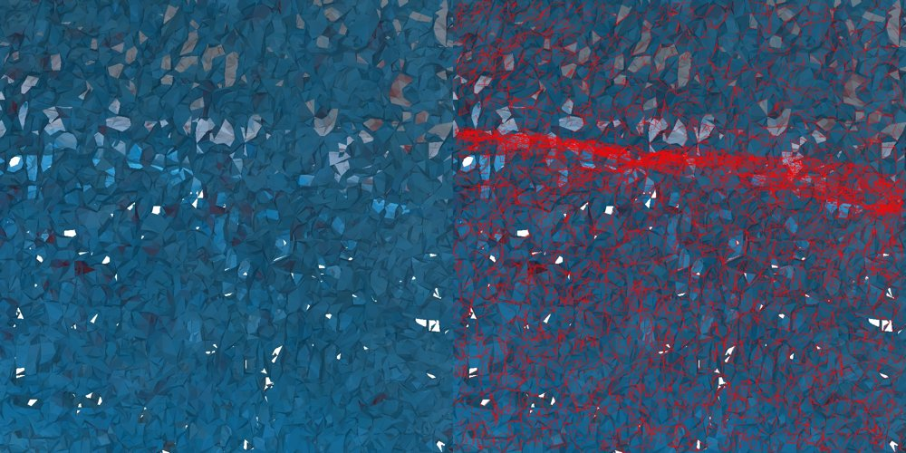
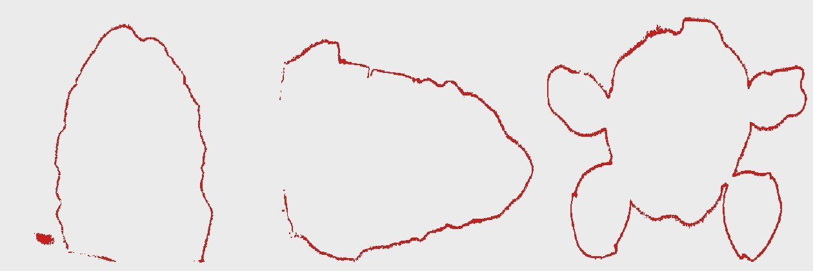
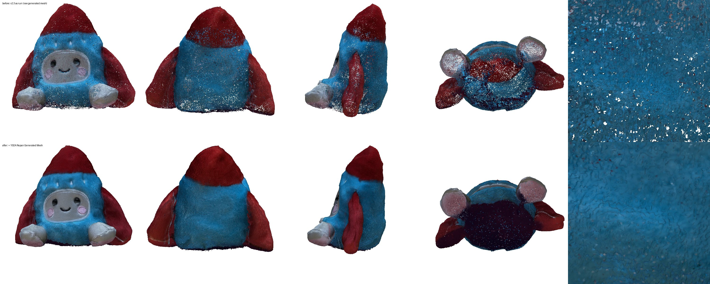

# 0013 — v2.3.1: the "tiny holes" in the final model, and repairing the generated mesh

- **Date:** 2026-11-09
- **Status:** done offline (nodes tested under `torch.inference_mode()`); the Desktop re-run needs a restart (new node) and the updated workflow
- **Stage(s):** G (generation post-processing), mesh repair, evaluation
- **Builds on:** #0009 (Mac port), #0011 (v2 workflow), #0012 (v2.2/v2.3)

## Question
The v2.3 final model in Comfy Desktop looks like it has a lot of tiny holes. Where do they come from, and can the same workflow fix them?

## Findings: root cause
1. **It isn't the viewer.**
   - SaveGLB writes `doubleSided: true` and no normals, so three.js draws both sides of every face.
   - The specks are real gaps. Rendered with an exact triangle rasteriser, they're white: the background showing through.
2. **It isn't the fit node.** The raw UniForge3D mesh already has them: 441,777 open edges, 12.3% of all edges. The hidden-face cull adds about 4% more.
3. **It is the Mac port's export step (#0009).**
   - UniForge3D (like TRELLIS.2) extracts a flexible-dual-grid mesh. On CUDA it then runs CuMesh: `fill_holes` (perimeter ≤ 3% of the box), then `remesh_narrow_band_dc`, then simplification to 1M faces. It does this even in the shape-only path.
   - CuMesh is CUDA-only, so the port replaced all of that with quadric decimation of the raw dual-grid mesh.
   - The raw dual-grid mesh already has holes and flipped faces (measured on a dump of the 512 stage). Quads are dropped wherever one of the 4 voxels around a crossing edge is missing. Quad winding is fixed per axis, not by which side is inside.
   - Decimating it without clean-up makes it worse. Up close, the 1024 output is a patchwork of overlapping patches with open edges everywhere; a hole appears wherever no patch covers: 

   | Mesh | faces | open edges | non-manifold edges | inconsistent winding | pieces |
   |---|---|---|---|---|---|
   | dual grid, 512 stage, before decimation | 3.60M | 4.7% | 6.7% | 16.7% | |
   | same, after the port's decimation | 1.00M | 6.8% | 15.5% | 25.6% | |
   | final 1024 output (`model.glb`) | 3.12M | 12.3% | 35.8% | 26.7% | 19,115 |

4. **The generated mesh has no bottom.** The photos never see the underside. Grid slices show the outline closed everywhere except at the base (red = surface): 

## Fix: node YSDA Repair Generated Mesh (between UniForge3D and the fit node)
`meshfix.remesh_narrow_band` is a CPU stand-in for CuMesh's hole filling plus narrow-band remesh:
- **Distances:** dense surface samples (24M), and their KD-tree distance at the grid points near the surface, on a grid of 512 cells along the longest side.
- **Surface:** the outer boundary of the band "distance < 1 cell", extracted with sparse surface nets. Each quad is wound towards the outside.
  - Holes narrower than about 2 cells close.
  - Overlapping patches merge into one sheet.
- **Outside region:** flood-filled from the grid border through points at least one more cell away from the surface, then grown back.
  - Gaps up to about 4 cells wide get a cap instead of a tunnel to the interior.
  - No inner shell is produced.
- **Bottom closing:** a point is interior if all 17 rays that don't point downward hit the surface (8 horizontal, 8 at 45° up, straight up).
  - This caps the open underside at about its rim.
  - The pockets between the fins and the body open diagonally, so they stay open.
  - Computed on a 2× coarser grid, with log-doubling shifts.
- **Colours:** from the nearest original surface point. Cap vertices, which are far from it, get colours by diffusion from their neighbours.
- **No morphological closing of the solid.** That was the step that merged the face plate with the body in #0012's watertight remesh; here the face plate stays separate.

Fit node changes:
- It culls hidden faces only when the mesh still has open edges, i.e. raw generator output. Culling a closed mesh would only cut holes in folds that no test direction sees.
- It keeps the winding outward after the display transform (positive signed volume).
- It writes smooth normals, which SaveGLB stores as the glTF `NORMAL` attribute.

## Results
| | faces | open edges | non-manifold edges | inconsistent winding | pieces |
|---|---|---|---|---|---|
| raw UniForge3D mesh | 3.12M | 441,777 | 1,280,508 | 26.7% | 19,115 |
| **repaired (512)** | **1.85M** | **0** | 7,936 | **0%** | 67 |

- The repair takes 21 s on CPU in the node. The fit node then runs in 270 s (registration IoU 0.676 → 0.962).
- Before (top) vs after (bottom), with a close-up of the back on the right: 
- Held-out photos IMG_4506/4510/4516 (`REPAIR=1 ONLY=uf3d_k8 scripts/eval_v2.py`, same protocol as #0012):

| Method | PSNR full | PSNR covered | Coverage | Silhouette IoU |
|---|---|---|---|---|
| v1.2 (reconstruction) | 17.61 | 19.99 | 0.982 | 0.925 |
| v2.3 as run (raw mesh, hidden-face cull) | 17.18 | 19.45 | 0.980 | 0.962 |
| **v2.3 + repair** | **17.82** | **20.58** | 0.980 | **0.962** |

The repair removes the holes, and it also improves held-out photo fidelity by +0.64 dB (full) and +1.13 dB (covered). For the first time, v2 beats v1.2 on all three metrics. Clean, consistently wound geometry gives correct visibility and colour weights, and there's no inner junk to catch photo colours.

## What went wrong on the way
1. **Band-only offset surface (no flood fill).**
   - The holes closed, but the inner offset shell stayed: 8.6M faces.
   - Around raw holes wider than 2 cells, it formed tunnels, which showed grey inner colours.
2. **Flood-filling the outside to drop the inner shell changed nothing,** even with wider sealing. The interior is reachable through the open bottom (item 4 above).
3. **Bottom closing with only the axis rays (±x, ±z, +y)** also filled the pockets between the fins and the body: 25.6M faces, 9.5M vertices far from the input. Using 17 directions fixed it.
4. **KD-tree queries from cap vertices** (far from every sample) were pathologically slow, over 15 minutes. Bounding the query distance and diffusing colours fixed it.
5. **Resolution 768** gives 4.8M faces (115 MB GLB). 512 gives 1.85M faces (55 MB with normals), with the same look and about the same vertex count as before (photo colour detail is per vertex).

## Conclusion
- The root cause is that the Mac port skipped the generator's own mesh clean-up.
- Repairing downstream fixes the holes (open edges go to 0) and closes the bottom.
- It also improves held-out photo fidelity.
- The UniForge3D cache stays valid, because the port code is unchanged.

## Artifacts
- **Node YSDA Repair Generated Mesh (v2):**
  - `ysda3d/meshfix.remesh_narrow_band`, plus `edge_stats` and `signed_volume`;
  - the report shows the input and repaired edge statistics.
- **Workflow** `workflows/photos_to_3d_v2_3_fused.ui.json` (Desktop: `ysda_photos_to_3d_v2_3_fused`): new F0 repair node and report; the fit node takes the repaired mesh.
  - 2026-11-10: the repair node moved into the G group (G1). G's 3D preview now shows the repaired model; the raw GLB stays in the UniForge3D run folder.
- **Model** `models/toy/v2_3_1_repaired_k8.glb`: decimated to 600k faces for the repo, 10.8 MB, still 0 open edges. The workflow's own output has 1.85M faces.
- **Evaluation:** `scripts/eval_v2.py` accepts `REPAIR=1` (`REPAIR_RES`, default 512) and `ONLY=<variant>`.

## Next
1. The bottom cap's colour is a guess (dark, diffused from the rim). The photos can't tell; a neutral base colour may look better.
2. Repair inside the port before decimation, from the full-resolution dual-grid mesh, as UniForge3D itself does. This needs a 35-minute regeneration, since the port's code hash is part of the cache key.
3. v2.1 view selection from COLMAP poses; v2.4 next-best-view (observed fraction is now 0.72, since the bottom cap is unobserved).
